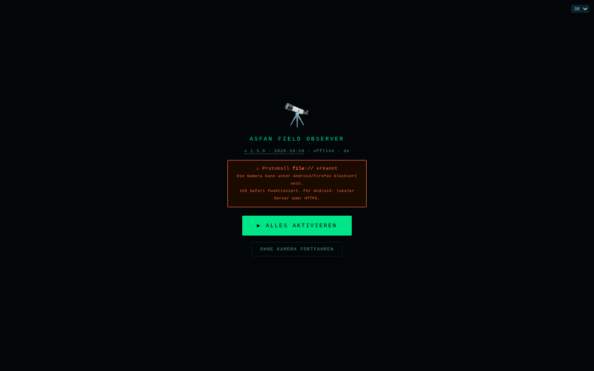

# Field Observer

[English](README.md) · [Română](README.ro.md) · [Français](README.fr.md) · [Italiano](README.it.md) · [Español](README.es.md) · [Português](README.pt.md) · **Deutsch** · [Magyar](README.hu.md)

**Version:** 1.3.1 · **Zuletzt aktualisiert:** 2026-10-22

Oberflächensprachen: **Română, English, Français, Italiano, Español, Português (PT), Deutsch, Magyar**

Feldbeobachter auf dem Smartphone: GPS, Kompass, Bewegung, Licht, Ton, Kamera, NFC und lokal gespeicherte Berichte.

**Online-App:** https://chiuta.github.io/FieldObserver/

## Was es ist

ASFAN Field Observer (v1.2.0) ist eine Single-File-Anwendung für das Smartphone, die die Sensordaten des Geräts in Echtzeit anzeigt und das Speichern von Feld-„Berichten“ (Sensordaten, Notiz, Foto, Audioaufnahme) erlaubt. Die Oberfläche hat 8 Sprachen (RO, EN, FR, IT, ES, PT, DE, HU).

## Funktionen

- Statusleiste: Uhr, Licht (Lux), Netzwerk, Akkustand, GPS-Koordinaten.
- Schaltfläche „▶ ACTIVARE COMPLETĂ“, die die nötigen Berechtigungen mit einer einzigen Geste anfordert; „RESET PERMISIUNI“ zum Neustart; „CONTINUĂ FĂRĂ CAMERĂ“ öffnet die App auch dann, wenn Kamera/Mikrofon nicht verfügbar sind (Desktop, file://).
- Sucher mit Kamera (Rück-/Frontkamera; Doppeltippen wechselt die Kamera), mit einer grafischen Überlagerung.
- Panels: **BUSOLĂ** (Azimut und Richtung), **MIȘCARE** (Beschleunigung m/s², Winkelgeschwindigkeit °/s), **AUDIO** (Pegel in dB), **LUMINĂ** (Lux, falls der Sensor vorhanden ist), **BATERIE**, **REȚEA**.
- Schaltflächen: START (Kamera), **FOTO**, **AUDIO** (Aufnahme), **TORȚĂ** (wenn das Gerät es erlaubt), **NFC**, **SALVARE**, **ARHIVĂ**.
- Erkennung von QR-/EAN-13-/Code-128-/Data-Matrix-/Aztec-Codes im Kamerabild, wo der Browser `BarcodeDetector` unterstützt.
- Notizfeld mit Sprachdiktat (`ro-RO`, falls der Browser Spracherkennung bietet), Sprachbestätigungen („Raport salvat“) und Vibration.
- Wake Lock, um den Bildschirm eingeschaltet zu lassen, wo verfügbar.
- Berichtsarchiv: Fotoansicht, Audiowiedergabe, Teilen (Web Share oder Kopieren in die Zwischenablage), JSON-Download, Löschen; Suche nach Notiz/Datum, Export des gesamten Archivs (JSON mit Foto/Audio) oder der Tabelle (CSV, ohne Medien), Import eines zuvor exportierten JSON (Felder geprüft), Koordinaten mit N/S und O/W (V auf Rumänisch) und ein „Karte“-Link (`geo:`, öffnet die Karten-App des Telefons), Esc schließt das Panel.

## Neu (1.1.0)

- **GPS-Track** (Schaltfläche 🥾 TRASEU in der unteren Leiste): zeichnet Positionen auf, solange die Seite geöffnet und aktiv bleibt. Ein Punkt wird mindestens 5 m vom vorherigen entfernt hinzugefügt, und Positionen mit einer Genauigkeit schlechter als 100 m werden ignoriert; das Limit liegt bei 50.000 Punkten pro Track. Der Track wird schrittweise in IndexedDB gespeichert (der Store `tracks`). **Einschränkung:** Browser liefern einer Seite im Hintergrund oder bei ausgeschaltetem Bildschirm kein GPS; in dem Fall fehlen die Punkte für dieses Intervall (es wird nichts interpoliert).
- **GPX-1.1-Export** (Archiv → ⬇ GPX): Berichtspositionen werden zu Punkten (`wpt`, mit Höhe, Zeit, Notiz, Azimut und Genauigkeit in der Beschreibung), und Tracks werden zu `trk`/`trkseg`. Es lässt sich in jedem Karten- oder GPS-Programm öffnen, das GPX liest. Berichte ohne GPS werden ausgelassen (es werden keine Koordinaten erfunden).
- **`.fff.json`-Paket** (Archiv → ⬇ .fff.json): das gesamte Archiv (Berichte mit Foto/Audio und Tracks) in einer Datei im Format `fff-bundle`, ebenfalls aus dem Archiv importierbar (⬆ IMPORT, das jetzt auch dieses Format akzeptiert; `app` wird geprüft). **Hinweis:** Die Sicherung im Fenster „Transparenz“ des Kits arbeitet nur mit `localStorage`, und die App nutzt es nicht; für das Archiv verwende die Schaltflächen im Archiv-Panel.
- **QR-Code am Bericht** (▦ QR bei jedem Bericht): Der Code enthält entweder die Position (`geo:lat,lon`, die das Telefon in der Karten-App öffnet) oder einen kurzen Text mit Datum, Position, Azimut und Notiz (die ersten 300 Zeichen). Lokal erzeugt.
- **Drucken** (Archiv → 🖨 TIPĂREȘTE): saubere Liste, weißer Hintergrund, ohne Schaltflächen und ohne Fotos.
- **Transparenz** (Archiv → ℹ TRANSPARENȚĂ): das Standardfenster „ohne Grenzen“ mit Netzwerk (0 externe Anfragen), Speicher, Berechtigungen und Dateiprüfung per SHA-256.

Die Oberfläche hat 8 Sprachen (RO, EN, FR, IT, ES, PT, DE, HU); die Übersetzungen außer Rumänisch sind automatisch und nicht von Muttersprachlern geprüft.

## Kit „fff-kit“

In `index.html` eingebettete Module: `core`, `label`, `bundle`, `qr` (QR-Code-Generator, ohne Netzwerk). Ohne sie funktioniert die App genauso, aber ohne die QR-Schaltfläche und ohne das Transparenz-Fenster (getestet). Die Datei `app.json` beschreibt das Netzwerk, die Berechtigungen und den SHA-256 der Datei.

## Tests

`node tests/fff-r8.test.mjs` (Playwright, Netzwerk blockiert): Track mit über den Testkontext simulierten Positionen (die echte Geolocation-API des Browsers), GPX (wohlgeformtes XML, Sonderzeichen), `.fff.json`-Paket (Export, Import, Zurückweisen eines fremden Pakets), QR-Code, der mit dem Decoder des Kits zurückdekodiert wird, Drucken, axe-core 0 Verstöße (einschließlich Dialoge), 360 px, ohne das Kit.

## Anleitung

1. Öffne die Seite auf dem Smartphone, über **HTTPS** oder `localhost` (die Kamera funktioniert nicht über ungesichertes HTTP; die App zeigt eine Warnung).
2. Drücke „▶ ACTIVARE COMPLETĂ“ und erteile die Berechtigungen (Standort, Kamera, Mikrofon, Bewegungs-/Orientierungssensoren).
3. Beobachte die Panels BUSOLĂ, MIȘCARE, AUDIO, LUMINĂ, BATERIE, REȚEA.
4. Drücke „START“ für die Kamera; Doppeltippen auf das Bild wechselt die Kamera. Nutze „FOTO“, „AUDIO“ (Aufnahme starten/stoppen) und „TORȚĂ“.
5. Schreibe eine Notiz in das Textfeld (oder diktiere sie mit der Mikrofon-Schaltfläche).
6. Drücke „SALVARE“: Der Bericht (Zeit, GPS, Ausrichtung, Bewegung, Licht, Akku, Netzwerk, Notiz, letztes Foto / letzte Audioaufnahme) wird lokal gespeichert. Ist die Datenbank nicht verfügbar oder schlägt das Speichern fehl, wird eine JSON-Datei heruntergeladen.
7. „ARHIVĂ“ listet die Berichte auf; dort kannst du sie suchen, ansehen, teilen, herunterladen (JSON), löschen, alles exportieren (JSON/CSV) oder ein zuvor exportiertes JSON importieren.
8. „◈ NFC“ startet das Lesen von NFC-Tags (wo der Browser Web NFC unterstützt).

## Datenschutz und Netzwerk

- **Lokaler Speicher:** IndexedDB, Datenbank `ASFAN_FO` (Version 3), Stores `recs` (die Berichte, einschließlich Foto und Audio) und `tracks` (die GPS-Tracks, seit 1.1.0; die alte Datenbank wird automatisch aktualisiert, die Berichte bleiben erhalten). `localStorage` wird nicht verwendet.
- **Netzwerk:** Die App enthält keine `fetch`-Aufrufe und hat eine CSP-Richtlinie mit `connect-src 'self'`; sie kontaktiert keine Drittanbieter-Hosts. Der Link „Coffee“ öffnet sich nur per Klick.
- Hinweis: Das Sprachdiktat nutzt die Spracherkennungsfunktion des Browsers, die in manchen Browsern (z. B. Chrome) Audio an den Dienst des Browseranbieters senden kann; die App kontrolliert diesen Aspekt nicht.
- **Sensible Daten:** Die Berichte enthalten GPS-Standort, Fotos, Audioaufnahmen und Notizen, unverschlüsselt in IndexedDB auf dem Gerät gespeichert; die Schaltfläche „SHARE“ und der JSON-Download können sie aus der App herausholen. Das Löschen der Websitedaten löscht das Archiv; exportiere JSON als Sicherung. Auf einem gemeinsam genutzten oder verlorenen Telefon können die Berichte von jedem gelesen werden, der Zugriff auf das Browserprofil hat.
- Keine Analytics.

## Lokal / offline ausführen

Lade `index.html` herunter und öffne sie über `localhost` (z. B. `python3 -m http.server 8080`) oder von einem HTTPS-Host; Sensoren und Kamera erfordern einen sicheren Kontext. Kein Internet erforderlich. Die Verfügbarkeit der Sensoren hängt vom Gerät und vom Browser ab.

## Verlauf / Changelog

### 1.3.1 — 2026-10-22
- GPS wird beim Öffnen der App nicht mehr angefordert: die Berechtigungsabfrage erscheint bei der ersten Interaktion (oder sofort, wenn sie bereits erteilt war).
- Die Löschbestätigung eines Eintrags ist ein übersetzter modaler Dialog statt des Browser-confirm().
- Barrierefreiheit: Notizfeld und Archiv-Importfeld haben Namen, die von Screenreadern angesagt werden.
- Mobil: Der Text ist mindestens 12 px groß, und Schaltflächen und Felder haben auf schmalen Bildschirmen größere Touch-Flächen.

### 18. Oktober 2026 — Version 1.2.0
- Neu: „↗ Bolta“ (der Himmel an der GPS-Position: live in der GPS-Leiste; im Archiv, für neue Berichte, am Ort und zum Zeitpunkt des Berichts). Neue Berichte behalten den UTC-Zeitpunkt (`t`), der auch im GPX verwendet wird. Die Position im Link wird auf ~1 km gerundet.

### 14. Oktober 2026 — Version 1.1.0
- Neu: GPS-Track, GPX-1.1-Export, `.fff.json`-Paket (Export/Import), QR-Code am Bericht (Position oder Text), Drucken des Archivs, Fenster „Transparenz“ (fff-kit: core, label, bundle, qr). Die IndexedDB-Datenbank wechselt zu Version 3 (neuer Store `tracks`). Neue Tests: `tests/fff-r8.test.mjs`. CSP: Hash des Skripts neu berechnet.

### 12. Oktober 2026 — Version 1.0.4
- 1.0.4 — 2026-10-12: Die Version und das Datum der letzten Aktualisierung werden in der App angezeigt

### 11. Oktober 2026 (dritter Durchgang) — Version 1.0.3
- CSV-Export: Die Spalte `baterie_pct` schrieb den Bruch 0–1 (1 für 100 %); jetzt schreibt sie den Prozentwert (100).
- Der Aktivierungsbildschirm blockiert die App nicht mehr, wenn die Kamera nicht verfügbar ist (file://, Desktop): Schaltfläche „CONTINUĂ FĂRĂ CAMERĂ“. CSP: Hash neu berechnet.

### 11. Oktober 2026 (zweiter Durchgang) — Version 1.0.2
- Archiv: Suche, vollständiger JSON- und CSV-Export (Zellen gegen Interpretation als Formeln geschützt), JSON-Import mit Feldvalidierung, Koordinaten mit korrekten Hemisphären (N/S, O/W (V auf Rumänisch); zuvor festes „°N/°E“, auch bei negativen Werten) und „Karte“-Link, Meldung bei leerem Archiv mit Hinweisen, `aria-label` an den Emoji-Schaltflächen, Dialog mit Fokus und Esc, Toast als `status`-Region. CSP: Hash neu berechnet. Screenshot aktualisiert.

### 11. Oktober 2026
- Version 1.0.1 (im Titel, auf dem Startbildschirm und im Code-Kommentar).
- Barrierefreiheit: Kopfbereich (`<header>` mit `<h1>`), `<main>` und das Unterstützungs-Widget als Landmark; axe-core meldet 0 Verstöße bei 1280 und 360 px.
- Die Buy-Me-a-Coffee-Pille verdeckt die Schaltflächenleiste (AUDIO, TORȚĂ, NFC, ARHIVĂ) nicht mehr: Sie sitzt rechts, in der Mitte des Suchers, und startet auf schmalem Bildschirm eingeklappt.
- Die Schaltfläche „ACTIVARE COMPLETĂ“ blieb nach der Aktivierung auf „⏳...“: Jetzt zeigt sie „✓ ACTIV“.
- Sicherheit: Die 15 Inline-`onclick`-Handler wurden durch einen delegierten Handler ersetzt; die CSP verwendet einen SHA-256-Hash für das Skript, ohne `'unsafe-inline'` in `script-src`.

## Lizenz

MIT — siehe die Datei LICENSE

## Audit

2026-10-10: geprüft, dass der Code kein `fetch`/XHR/WebSocket und keine externen Ressourcen enthält (mit simulierten Berechtigungen, ohne Netzwerkanfragen). Der App-Name in der Oberfläche und der der Datenbank (`ASFAN_FO`) enthalten „ASFAN“; er wurde nicht geändert. Behoben wurden der blockierte Zoom (Viewport), der Kontrast und ein ausgeblendetes fokussierbares Element.

## Autor

Alexio — Alexandru-Ionuț Chiuță. Kontakt: alexio@trom.tf

## Zusammenfassung

Field Observer ist ein rumänischsprachiges mobiles Feldwerkzeug in einer einzigen Datei: Live-GPS, Kompass, Bewegung, Umgebungslicht, Audiopegel, Kamera mit QR-/Barcode-Erkennung, Taschenlampe und NFC, dazu gespeicherte Feldberichte (IndexedDB-Datenbank `ASFAN_FO`) mit Notizen, Foto und Audio, JSON-Export und Teilen. Keine Netzwerkanfragen (CSP connect-src 'self'). MIT-Lizenz.

Neu in 1.1.0: GPS-Spuraufzeichnung (nur im Vordergrund), GPX-1.1-Export von Berichten und Spuren, `.fff.json`-Archivpaket (Export/Import), QR-Code pro Bericht (geo:-Position oder kurzer Text), Druckansicht des Archivs und der Dialog „Transparenz“. Die Oberfläche bleibt ausschließlich auf Rumänisch. Das Kit fügt keine Netzwerkanfragen hinzu.
