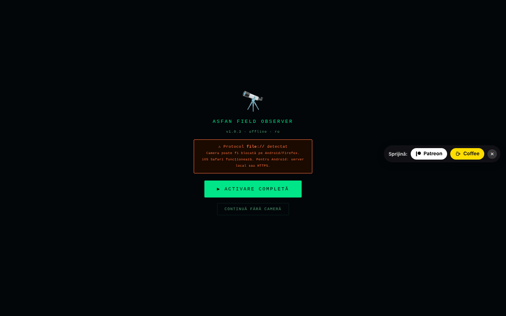

# Field Observer

[English](README.md) · [Română](README.ro.md) · [Français](README.fr.md) · [Italiano](README.it.md) · **Español** · [Português](README.pt.md) · [Deutsch](README.de.md) · [Magyar](README.hu.md)

**Versión:** 1.3.0 · **Última actualización:** 2026-10-19

Idiomas de la interfaz: **Română, English, Français, Italiano, Español, Português (PT), Deutsch, Magyar**

Observador de campo en el teléfono: GPS, brújula, movimiento, luz, sonido, cámara, NFC e informes guardados localmente.

**Aplicación en línea:** https://chiuta.github.io/FieldObserver/

## Qué es

ASFAN Field Observer (v1.2.0) es una aplicación de un único archivo, pensada para el teléfono, que muestra en tiempo real los datos de los sensores del dispositivo y permite guardar «informes» de campo (datos de sensores, nota, foto, grabación de audio). La interfaz tiene 8 idiomas (RO, EN, FR, IT, ES, PT, DE, HU).

## Funciones

- Barra de estado: reloj, luz (lux), red, nivel de batería, coordenadas GPS.
- Botón «▶ ACTIVARE COMPLETĂ» que solicita los permisos necesarios con un solo gesto; «RESET PERMISIUNI» para empezar de nuevo; «CONTINUĂ FĂRĂ CAMERĂ» abre la aplicación aunque la cámara/el micrófono no estén disponibles (escritorio, file://).
- Visor con cámara (trasera/frontal; el doble toque cambia de cámara), con una superposición gráfica.
- Paneles: **BUSOLĂ** (acimut y dirección), **MIȘCARE** (aceleración m/s², velocidad angular °/s), **AUDIO** (nivel en dB), **LUMINĂ** (lux, si existe el sensor), **BATERIE**, **REȚEA**.
- Botones: START (cámara), **FOTO**, **AUDIO** (grabación), **TORȚĂ** (si el dispositivo lo permite), **NFC**, **SALVARE**, **ARHIVĂ**.
- Detección de códigos QR / EAN-13 / Code 128 / Data Matrix / Aztec en la imagen de la cámara, donde el navegador admita `BarcodeDetector`.
- Campo de nota con dictado por voz (`ro-RO`, si el navegador ofrece reconocimiento de voz), confirmaciones por voz («Raport salvat») y vibraciones.
- Wake Lock para mantener la pantalla encendida, donde esté disponible.
- Archivo de informes: visualización de fotos, reproducción de audio, compartir (Web Share o copia al portapapeles), descarga en JSON, eliminación; búsqueda por nota/fecha, exportación de todo el archivo (JSON con foto/audio) o de la tabla (CSV, sin medios), importación de un JSON exportado anteriormente (campos verificados), coordenadas con N/S y E/O (V en rumano) y enlace «mapa» (`geo:`, abre la aplicación de mapas del teléfono), Esc cierra el panel.

## Novedades (1.1.0)

- **Recorrido GPS** (botón 🥾 TRASEU de la barra inferior): registra las posiciones mientras la página permanece abierta y activa. Se añade un punto a al menos 5 m del anterior y se ignoran las posiciones con una precisión peor de 100 m; el límite es de 50 000 puntos por recorrido. El recorrido se guarda de forma progresiva en IndexedDB (el almacén `tracks`). **Limitación:** los navegadores no proporcionan GPS a una página en segundo plano o con la pantalla apagada; en ese caso faltan puntos en ese intervalo (no se interpola nada).
- **Exportación GPX 1.1** (archivo → ⬇ GPX): las posiciones de los informes se convierten en puntos (`wpt`, con altitud, hora, nota, acimut y precisión en la descripción), y los recorridos se convierten en `trk`/`trkseg`. Se abre en cualquier programa de mapas o GPS que lea GPX. Los informes sin GPS se omiten (no se inventan coordenadas).
- **Paquete `.fff.json`** (archivo → ⬇ .fff.json): todo el archivo (informes, con foto/audio, y recorridos) en un archivo de formato `fff-bundle`, importable también desde el archivo (⬆ IMPORT, que ahora acepta también este formato; se comprueba `app`). **Nota:** la copia de seguridad de la ventana «Transparencia» del kit solo trabaja con `localStorage`, y la aplicación no lo usa; para el archivo, utiliza los botones del panel Archivo.
- **Código QR en el informe** (▦ QR en cada informe): el código contiene la posición (`geo:lat,lon`, que el teléfono abre en la aplicación de mapas) o un texto breve con la fecha, la posición, el acimut y la nota (los primeros 300 caracteres). Se genera localmente.
- **Impresión** (archivo → 🖨 TIPĂREȘTE): lista limpia, fondo blanco, sin botones y sin fotografías.
- **Transparencia** (archivo → ℹ TRANSPARENȚĂ): la ventana estándar «sin fronteras» con la red (0 solicitudes externas), el almacenamiento, los permisos y la verificación del archivo mediante SHA-256.

La interfaz tiene 8 idiomas (RO, EN, FR, IT, ES, PT, DE, HU); las traducciones distintas del rumano son automáticas y no están verificadas por hablantes nativos.

## Kit «fff-kit»

Módulos integrados en `index.html`: `core`, `label`, `bundle`, `qr` (generador de códigos QR, sin red). Sin ellos la aplicación funciona igual, pero sin el botón QR y sin la ventana Transparencia (probado). El archivo `app.json` describe la red, los permisos y el SHA-256 del archivo.

## Pruebas

`node tests/fff-r8.test.mjs` (Playwright, red bloqueada): recorrido con posiciones simuladas a través del contexto de prueba (la API real de geolocalización del navegador), GPX (XML bien formado, caracteres especiales), paquete `.fff.json` (exportación, importación, rechazo de un paquete ajeno), código QR decodificado de vuelta con el decodificador del kit, impresión, axe-core 0 infracciones (incluidos los diálogos), 360 px, sin el kit.

## Guía de uso

1. Abre la página en el teléfono, mediante **HTTPS** o `localhost` (la cámara no funciona con HTTP no seguro; la aplicación muestra una advertencia).
2. Pulsa «▶ ACTIVARE COMPLETĂ» y concede los permisos (ubicación, cámara, micrófono, sensores de movimiento/orientación).
3. Observa los paneles BUSOLĂ, MIȘCARE, AUDIO, LUMINĂ, BATERIE, REȚEA.
4. Pulsa «START» para la cámara; el doble toque sobre la imagen cambia de cámara. Usa «FOTO», «AUDIO» (inicio/parada de la grabación) y «TORȚĂ».
5. Escribe una nota en el campo de texto (o dictala con el botón del micrófono).
6. Pulsa «SALVARE»: el informe (hora, GPS, orientación, movimiento, luz, batería, red, nota, última foto / grabación de audio) se guarda localmente. Si la base de datos no está disponible o el guardado falla, se descarga un archivo JSON.
7. «ARHIVĂ» lista los informes; desde ahí puedes buscarlos, verlos, compartirlos, descargarlos (JSON), eliminarlos, exportarlo todo (JSON/CSV) o importar un JSON exportado anteriormente.
8. «◈ NFC» inicia la lectura de etiquetas NFC (donde el navegador admita Web NFC).

## Privacidad y red

- **Almacenamiento local:** IndexedDB, base de datos `ASFAN_FO` (versión 3), almacenes `recs` (los informes, incluidas foto y audio) y `tracks` (los recorridos GPS, desde la 1.1.0; la base antigua se actualiza automáticamente, los informes permanecen). No se usa `localStorage`.
- **Red:** la aplicación no contiene llamadas `fetch` y tiene una política CSP con `connect-src 'self'`; no contacta con hosts de terceros. El enlace «Coffee» solo se abre al hacer clic.
- Nota: el dictado por voz usa la función de reconocimiento de voz del navegador, que en algunos navegadores (p. ej., Chrome) puede enviar audio al servicio del proveedor del navegador; la aplicación no controla este aspecto.
- **Datos sensibles:** los informes contienen la ubicación GPS, fotografías, grabaciones de audio y notas, almacenados sin cifrar en IndexedDB en el dispositivo; el botón «SHARE» y la descarga en JSON pueden sacarlos de la aplicación. Borrar los datos del sitio elimina el archivo; exporta el JSON como copia de seguridad. En un teléfono compartido o perdido, los informes pueden ser leídos por cualquiera que tenga acceso al perfil del navegador.
- Sin analítica.

## Ejecución local / sin conexión

Descarga `index.html` y ábrelo mediante `localhost` (p. ej., `python3 -m http.server 8080`) o desde un host HTTPS; los sensores y la cámara requieren un contexto seguro. No requiere internet. La disponibilidad de los sensores depende del dispositivo y del navegador.

## Historial / Changelog

### 18 de octubre de 2026 — versión 1.2.0
- Nuevo: «↗ Bolta» (el cielo en la posición GPS: en vivo en la barra GPS; en el archivo, para los informes nuevos, en el lugar y el momento del informe). Los informes nuevos conservan el instante UTC (`t`), usado también en el GPX. La posición del enlace se redondea a ~1 km.

### 14 de octubre de 2026 — versión 1.1.0
- Nuevo: recorrido GPS, exportación GPX 1.1, paquete `.fff.json` (exportación/importación), código QR en el informe (posición o texto), impresión del archivo, ventana «Transparencia» (fff-kit: core, label, bundle, qr). La base IndexedDB pasa a la versión 3 (nuevo almacén `tracks`). Pruebas nuevas: `tests/fff-r8.test.mjs`. CSP: hash del script recalculado.

### 12 de octubre de 2026 — versión 1.0.4
- 1.0.4 — 2026-10-12: la versión y la fecha de la última actualización se muestran en la aplicación

### 11 de octubre de 2026 (tercera pasada) — versión 1.0.3
- Exportación CSV: la columna `baterie_pct` escribía la fracción 0–1 (1 para el 100 %); ahora escribe el porcentaje (100).
- La pantalla de activación ya no bloquea la aplicación cuando la cámara no está disponible (file://, escritorio): botón «CONTINUĂ FĂRĂ CAMERĂ». CSP: hash recalculado.

### 11 de octubre de 2026 (segunda pasada) — versión 1.0.2
- Archivo: búsqueda, exportación completa en JSON y CSV (celdas protegidas contra su interpretación como fórmulas), importación JSON con validación de campos, coordenadas con los hemisferios correctos (N/S, E/O (V en rumano); antes «°N/°E» fijo, incluso para valores negativos) y enlace «mapa», mensaje de archivo vacío con orientación, `aria-label` en los botones con emoji, diálogo con foco y Esc, toast como región `status`. CSP: hash recalculado. Captura actualizada.

### 11 de octubre de 2026
- Versión 1.0.1 (en el título, la pantalla de inicio y el comentario del código).
- Accesibilidad: cabecera (`<header>` con `<h1>`), `<main>` y el widget de apoyo como punto de referencia; axe-core informa de 0 infracciones a 1280 y 360 px.
- La píldora Buy Me a Coffee ya no tapa la barra de botones (AUDIO, TORȚĂ, NFC, ARHIVĂ): queda a la derecha, a mitad del visor, y en pantalla estrecha empieza contraída.
- El botón «ACTIVARE COMPLETĂ» se quedaba en «⏳...» tras la activación: ahora muestra «✓ ACTIV».
- Seguridad: los 15 controladores `onclick` en línea se sustituyeron por un controlador delegado; la CSP usa un hash SHA-256 para el script, sin `'unsafe-inline'` en `script-src`.

## Licencia

MIT — véase el archivo LICENSE

## Auditoría

2026-10-10: se verificó que el código no contiene `fetch`/XHR/WebSocket ni recursos externos (con permisos simulados, sin solicitudes de red). El nombre de la aplicación en la interfaz y el de la base de datos (`ASFAN_FO`) contienen «ASFAN»; no se modificó. Se corrigieron el zoom bloqueado (viewport), el contraste y un elemento oculto enfocable.

## Autor

Alexio — Alexandru-Ionuț Chiuță. Contacto: alexio@trom.tf

## English summary

Field Observer is a single-file, Romanian-language mobile field tool: live GPS, compass, motion, ambient light, audio level, camera with QR/barcode detection, torch and NFC, plus saved field reports (IndexedDB database `ASFAN_FO`) with notes, photo and audio, JSON export and sharing. No network requests (CSP connect-src 'self'). MIT licence.

New in 1.1.0: GPS track recording (foreground only), GPX 1.1 export of reports and tracks, `.fff.json` archive bundle (export/import), QR code per report (geo: position or short text), print view of the archive, and the "Transparency" dialog. The UI remains Romanian-only. The kit adds no network requests.
