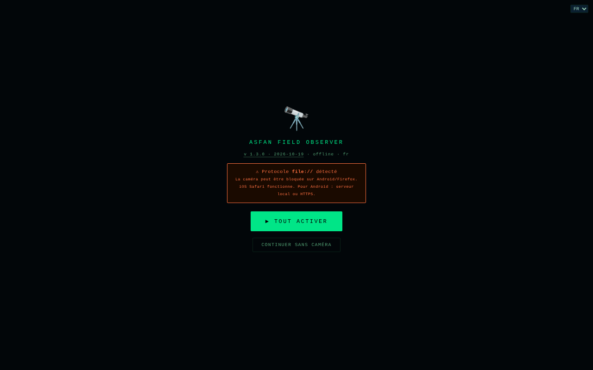

# Field Observer

[English](README.md) · [Română](README.ro.md) · **Français** · [Italiano](README.it.md) · [Español](README.es.md) · [Português](README.pt.md) · [Deutsch](README.de.md) · [Magyar](README.hu.md)

**Version :** 2.2.1 · **Dernière mise à jour :** 2026-10-28

**État:** stable · **Hors ligne:** complet

Langues de l'interface : **Română, English, Français, Italiano, Español, Português (PT), Deutsch, Magyar**

Observateur de terrain sur téléphone : GPS, boussole, mouvement, lumière, son, caméra, NFC et rapports enregistrés localement.

**Application en ligne :** https://chiuta.github.io/FieldObserver/

## De quoi s'agit-il

ASFAN Field Observer (v1.2.0) est une application en un seul fichier, conçue pour le téléphone, qui affiche en temps réel les données des capteurs de l'appareil et permet d'enregistrer des « rapports » de terrain (données des capteurs, note, photo, enregistrement audio). L'interface compte 8 langues (RO, EN, FR, IT, ES, PT, DE, HU).

## Fonctionnalités

- Barre d'état : horloge, lumière (lux), réseau, niveau de batterie, coordonnées GPS.
- Bouton « ▶ ACTIVARE COMPLETĂ » qui demande les autorisations nécessaires en un seul geste ; « RESET PERMISIUNI » pour recommencer ; « CONTINUĂ FĂRĂ CAMERĂ » ouvre l'application même lorsque la caméra/le microphone ne sont pas disponibles (ordinateur, file://).
- Viseur avec caméra (caméra arrière/avant ; un double appui change de caméra), avec une surimpression graphique.
- Panneaux : **BUSOLĂ** (azimut et direction), **MIȘCARE** (accélération m/s², vitesse angulaire °/s), **AUDIO** (niveau en dB), **LUMINĂ** (lux, si le capteur existe), **BATERIE**, **REȚEA**.
- Boutons : START (caméra), **FOTO**, **AUDIO** (enregistrement), **TORȚĂ** (si l'appareil le permet), **NFC**, **SALVARE**, **ARHIVĂ**.
- Détection de codes QR / EAN-13 / Code 128 / Data Matrix / Aztec dans l'image de la caméra, là où le navigateur prend en charge `BarcodeDetector`.
- Champ de note avec dictée vocale (`ro-RO`, si le navigateur propose la reconnaissance vocale), confirmations vocales (« Raport salvat ») et vibrations.
- Wake Lock pour garder l'écran allumé, là où il est disponible.
- Archive de rapports : visualisation des photos, lecture audio, partage (Web Share ou copie dans le presse-papiers), téléchargement JSON, suppression ; recherche par note/date, export de toute l'archive (JSON avec photo/audio) ou du tableau (CSV, sans médias), import d'un JSON exporté précédemment (champs vérifiés), coordonnées avec N/S et E/O (V en roumain) et lien « carte » (`geo:`, ouvre l'application de cartes du téléphone), Échap ferme le panneau.

## Nouveautés (1.1.0)

- **Tracé GPS** (bouton 🥾 TRASEU de la barre du bas) : enregistre les positions tant que la page reste ouverte et active. Un point est ajouté à au moins 5 m du précédent et les positions dont la précision est inférieure à 100 m sont ignorées ; la limite est de 50 000 points par tracé. Le tracé est enregistré progressivement dans IndexedDB (le magasin `tracks`). **Limite :** les navigateurs ne fournissent pas le GPS à une page en arrière-plan ou écran éteint ; dans ce cas, les points manquent pour cet intervalle (rien n'est interpolé).
- **Export GPX 1.1** (archive → ⬇ GPX) : les positions des rapports deviennent des points (`wpt`, avec altitude, heure, note, azimut et précision dans la description), et les tracés deviennent `trk`/`trkseg`. Il s'ouvre dans tout programme de cartes ou de GPS qui lit le GPX. Les rapports sans GPS sont omis (aucune coordonnée n'est inventée).
- **Paquet `.fff.json`** (archive → ⬇ .fff.json) : toute l'archive (rapports, avec photo/audio, et tracés) dans un fichier au format `fff-bundle`, également importable depuis l'archive (⬆ IMPORT, qui accepte désormais aussi ce format ; `app` est vérifié). **Remarque :** la sauvegarde de la fenêtre « Transparence » du kit ne fonctionne qu'avec `localStorage`, et l'application ne l'utilise pas ; pour l'archive, utilisez les boutons du panneau Archive.
- **Code QR sur le rapport** (▦ QR sur chaque rapport) : le code contient soit la position (`geo:lat,lon`, que le téléphone ouvre dans l'application de cartes), soit un court texte avec la date, la position, l'azimut et la note (300 premiers caractères). Généré localement.
- **Impression** (archive → 🖨 TIPĂREȘTE) : liste épurée, fond blanc, sans boutons et sans photos.
- **Transparence** (archive → ℹ TRANSPARENȚĂ) : la fenêtre standard « sans frontières » avec le réseau (0 requête externe), le stockage, les autorisations et la vérification du fichier par SHA-256.

L'interface compte 8 langues (RO, EN, FR, IT, ES, PT, DE, HU) ; les traductions autres que le roumain sont automatiques et non vérifiées par des locuteurs natifs.

## Kit « fff-kit »

Modules intégrés dans `index.html` : `core`, `label`, `bundle`, `qr` (générateur de code QR, sans réseau). Sans eux, l'application fonctionne de la même façon, mais sans le bouton QR et sans la fenêtre Transparence (testé). Le fichier `app.json` décrit le réseau, les autorisations et le SHA-256 du fichier.

## Tests

`node tests/fff-r8.test.mjs` (Playwright, réseau bloqué) : tracé avec positions simulées via le contexte de test (l'API de géolocalisation réelle du navigateur), GPX (XML bien formé, caractères spéciaux), paquet `.fff.json` (export, import, rejet d'un paquet étranger), code QR décodé en retour avec le décodeur du kit, impression, axe-core 0 violation (y compris les boîtes de dialogue), 360 px, sans le kit.

## Mode d'emploi

1. Ouvrez la page sur le téléphone, en **HTTPS** ou sur `localhost` (la caméra ne fonctionne pas en HTTP non sécurisé ; l'application affiche un avertissement).
2. Appuyez sur « ▶ ACTIVARE COMPLETĂ » et accordez les autorisations (localisation, caméra, microphone, capteurs de mouvement/orientation).
3. Suivez les panneaux BUSOLĂ, MIȘCARE, AUDIO, LUMINĂ, BATERIE, REȚEA.
4. Appuyez sur « START » pour la caméra ; un double appui sur l'image change de caméra. Utilisez « FOTO », « AUDIO » (démarrage/arrêt de l'enregistrement) et « TORȚĂ ».
5. Saisissez une note dans le champ de texte (ou dictez-la avec le bouton du microphone).
6. Appuyez sur « SALVARE » : le rapport (heure, GPS, orientation, mouvement, lumière, batterie, réseau, note, dernière photo / dernier enregistrement audio) est enregistré localement. Si la base de données n'est pas disponible ou si l'enregistrement échoue, un fichier JSON est téléchargé.
7. « ARHIVĂ » liste les rapports ; vous pouvez y les rechercher, les visualiser, les partager, les télécharger (JSON), les supprimer, tout exporter (JSON/CSV) ou importer un JSON exporté précédemment.
8. « ◈ NFC » lance la lecture des étiquettes NFC (là où le navigateur prend en charge Web NFC).

## Confidentialité et réseau

- **Stockage local :** IndexedDB, base `ASFAN_FO` (version 3), magasins `recs` (les rapports, y compris photo et audio) et `tracks` (les tracés GPS, depuis la 1.1.0 ; l'ancienne base est mise à jour automatiquement, les rapports restent). `localStorage` n'est pas utilisé.
- **Réseau :** l'application ne contient aucun appel `fetch` et a une politique CSP avec `connect-src 'self'` ; elle ne contacte aucun hôte tiers. Le lien « Coffee » ne s'ouvre qu'au clic.
- Remarque : la dictée vocale utilise la fonction de reconnaissance vocale du navigateur, qui dans certains navigateurs (p. ex. Chrome) peut envoyer de l'audio au service du fournisseur du navigateur ; l'application ne contrôle pas cet aspect.
- **Données sensibles :** les rapports contiennent la localisation GPS, des photos, des enregistrements audio et des notes, stockés non chiffrés dans IndexedDB sur l'appareil ; le bouton « SHARE » et le téléchargement JSON peuvent les faire sortir de l'application. L'effacement des données du site supprime l'archive ; exportez le JSON pour une sauvegarde. Sur un téléphone partagé ou perdu, les rapports peuvent être lus par quiconque a accès au profil du navigateur.
- Pas d'analytique.

## Exécution locale / hors ligne

Téléchargez `index.html` et ouvrez-le via `localhost` (p. ex. `python3 -m http.server 8080`) ou depuis un hôte HTTPS ; les capteurs et la caméra exigent un contexte sécurisé. Aucun accès à Internet n'est nécessaire. La disponibilité des capteurs dépend de l'appareil et du navigateur.

## Export Darwin Core (GBIF) et iNaturalist

Depuis l’Archive : **⬇ Darwin Core** et **⬇ iNaturalist** (CSV, UTF-8, sans BOM).

- **Darwin Core** (pour GBIF / IPT / le validateur GBIF) : `occurrenceID` (`urn:fieldobserver:<instant>`), `basisOfRecord=HumanObservation`, `occurrenceStatus=present`, `eventDate` (ISO 8601, UTC), `decimalLatitude`, `decimalLongitude`, `geodeticDatum=EPSG:4326`, `coordinateUncertaintyInMeters` (précision GPS), `minimumElevationInMeters`/`maximumElevationInMeters` (altitude GPS), `scientificName` (**vide**), `recordedBy` (vide), `occurrenceRemarks` (la note), `associatedMedia` (vide), `datasetName`, `dynamicProperties` (JSON : azimut, angle d’élévation, lux, batterie).
- **iNaturalist** lit les 8 premières colonnes du CSV **par position** (les noms d’en-tête sont ignorés) : Taxon name, Date observed, Description, Place name, Latitude, Longitude, Tags, Geoprivacy. Le fichier respecte cet ordre ; la date porte le décalage horaire local.
- **Important :** l’application ne saisit pas l’espèce ; `scientificName` / « Taxon name » sont donc vides. Renseignez-les (p. ex. dans un tableur) avant l’envoi, sinon GBIF/iNaturalist ne peuvent pas relier l’observation à un taxon. Les notes commençant par `=`, `+`, `-`, `@` reçoivent une apostrophe initiale (protection contre les formules de tableur).
- **Photos : prévu.** Elles ne sont pas incluses dans le CSV (images base64 énormes, non acceptées par GBIF comme `associatedMedia`) ; elles restent dans l’export JSON / `.fff.json`. Une archive Darwin Core avec l’extension Simple Multimedia (ZIP) n’est pas implémentée.
- La compatibilité avec les services externes a été testée sur la structure du fichier seulement, pas sur de vrais envois ; vérifiez le résultat dans le validateur GBIF / la page d’import iNaturalist.

## ZIP export with photos and audio (v2.2.0)

_(English only; not yet translated into this language. Machine translation intentionally not added to avoid errors in technical statements.)_

From the Archive: **⬇ ZIP + media** produces a ZIP (stored, CRC-32) with `occurrence.csv` (Darwin Core), photos and audio recordings as files in `media/`, and `LEAME-README.txt` (RO + EN). The `associatedMedia` column holds relative paths separated by ` | `. The ZIP was verified with Python's `zipfile` (CRC) and the media bytes by SHA-256 against IndexedDB (`tests/zip-media.test.mjs`).

**Limits (not simulated):**
- It is NOT a Darwin Core Archive (no `meta.xml`/`eml.xml`); GBIF expects public URLs for multimedia, so relative paths cannot be ingested there directly. Not tested with GBIF.
- `scientificName` stays empty: the app does not capture the species (it would be a schema change).
- The plain Darwin Core CSV is unchanged (no media). New labels in fr/it/es/pt/de/hu are machine translations, marked.

## Historique / Changelog

### 2.2.0 — 2026-10-27
- ZIP export with photos and audio as files (not a Darwin Core Archive).

- **2.1.0 — 2026-10-27 :** export **Darwin Core** (GBIF) et CSV **iNaturalist** depuis l’Archive (photos : prévu) ; lignes État/Hors ligne ; CHANGELOG.md (précédente : v2.0.0).

### 1.3.7 — 2026-10-23

- Fix: importing a .fff.json bundle whose inner content is `null` no longer throws an uncaught exception (it now reports “no valid records”); CSP hash recalculated.

### 1.3.6 — 2026-10-23
- Les boîtes natives alert/confirm/prompt sont remplacées par des dialogues FFF.dialog accessibles et traduits (fff-kit 1.2.0).

### 1.3.4 — 2026-10-22

fff-kit 1.1.4 : cibles tactiles et taille de texte minimale. Cibles tactiles/texte corrigés dans l’application.

### 1.3.3 — 2026-10-22
- Accessibilité : anneau de focus net sur la barre de notes (contraste d’au moins 3:1).

### 1.3.2 — 2026-10-22

fff-kit 1.1.2 : PBKDF2 600 000 itérations, protection anti-clickjacking.

### 1.3.1 — 2026-10-22
- Le GPS n'est plus demandé à l'ouverture : la demande d'autorisation apparaît à la première interaction (ou tout de suite si elle était déjà accordée).
- La confirmation de suppression d'un enregistrement est une boîte de dialogue modale traduite au lieu du confirm() du navigateur.
- Accessibilité : le champ de notes et le champ d'import d'archive ont des noms annoncés par les lecteurs d'écran.
- Mobile : le texte fait au moins 12 px et les boutons et champs ont des cibles tactiles plus grandes sur les écrans étroits.

### 18 octobre 2026 — version 1.2.0
- Nouveau : « ↗ Bolta » (le ciel à la position GPS : en direct dans la barre GPS ; dans l'archive, pour les nouveaux rapports, au lieu et au moment du rapport). Les nouveaux rapports conservent l'instant UTC (`t`), également utilisé dans le GPX. La position dans le lien est arrondie à ~1 km.

### 14 octobre 2026 — version 1.1.0
- Nouveau : tracé GPS, export GPX 1.1, paquet `.fff.json` (export/import), code QR sur le rapport (position ou texte), impression de l'archive, fenêtre « Transparence » (fff-kit : core, label, bundle, qr). La base IndexedDB passe à la version 3 (nouveau magasin `tracks`). Nouveaux tests : `tests/fff-r8.test.mjs`. CSP : hachage du script recalculé.

### 12 octobre 2026 — version 1.0.4
- 1.0.4 — 2026-10-12 : la version et la date de la dernière mise à jour sont affichées dans l'application

### 11 octobre 2026 (troisième passage) — version 1.0.3
- Export CSV : la colonne `baterie_pct` écrivait la fraction 0–1 (1 pour 100 %) ; elle écrit maintenant le pourcentage (100).
- L'écran d'activation ne bloque plus l'application lorsque la caméra n'est pas disponible (file://, ordinateur) : bouton « CONTINUĂ FĂRĂ CAMERĂ ». CSP : hachage recalculé.

### 11 octobre 2026 (deuxième passage) — version 1.0.2
- Archive : recherche, export complet JSON et CSV (cellules protégées contre l'interprétation comme formules), import JSON avec validation des champs, coordonnées avec les bons hémisphères (N/S, E/O (V en roumain) ; auparavant « °N/°E » fixe, même pour des valeurs négatives) et lien « carte », message d'archive vide avec indications, `aria-label` sur les boutons à emoji, boîte de dialogue avec focus et Échap, toast comme région `status`. CSP : hachage recalculé. Capture d'écran mise à jour.

### 11 octobre 2026
- Version 1.0.1 (dans le titre, l'écran de démarrage et le commentaire du code).
- Accessibilité : en-tête (`<header>` avec `<h1>`), `<main>` et le widget de soutien comme repère ; axe-core signale 0 violation à 1280 et 360 px.
- La pastille Buy Me a Coffee ne recouvre plus la barre de boutons (AUDIO, TORȚĂ, NFC, ARHIVĂ) : elle se place à droite, au milieu du viseur, et sur un écran étroit elle démarre repliée.
- Le bouton « ACTIVARE COMPLETĂ » restait sur « ⏳... » après l'activation : il affiche maintenant « ✓ ACTIV ».
- Sécurité : les 15 gestionnaires `onclick` en ligne ont été remplacés par un gestionnaire délégué ; la CSP utilise un hachage SHA-256 pour le script, sans `'unsafe-inline'` dans `script-src`.

## Licence

MIT — voir le fichier LICENSE

## Audit

2026-10-10 : vérifié que le code ne contient ni `fetch`/XHR/WebSocket ni ressources externes (avec des autorisations simulées, sans requêtes réseau). Le nom de l'application dans l'interface et celui de la base de données (`ASFAN_FO`) contiennent « ASFAN » ; il n'a pas été modifié. Corrigés : le zoom bloqué (viewport), le contraste et un élément masqué focalisable.

## Auteur

Alexio — Alexandru-Ionuț Chiuță. Contact : alexio@trom.tf

## Résumé

Field Observer est un outil de terrain mobile en roumain, en un seul fichier : GPS en direct, boussole, mouvement, lumière ambiante, niveau sonore, caméra avec détection de QR/codes-barres, lampe torche et NFC, ainsi que des rapports de terrain enregistrés (base IndexedDB `ASFAN_FO`) avec notes, photo et audio, export JSON et partage. Aucune requête réseau (CSP connect-src 'self'). Licence MIT.

Nouveau dans la 1.1.0 : enregistrement de traces GPS (au premier plan uniquement), export GPX 1.1 des rapports et des traces, archive groupée `.fff.json` (export/import), code QR par rapport (position geo: ou texte court), vue d'impression de l'archive et boîte de dialogue « Transparence ». L'interface reste uniquement en roumain. Le kit n'ajoute aucune requête réseau.

