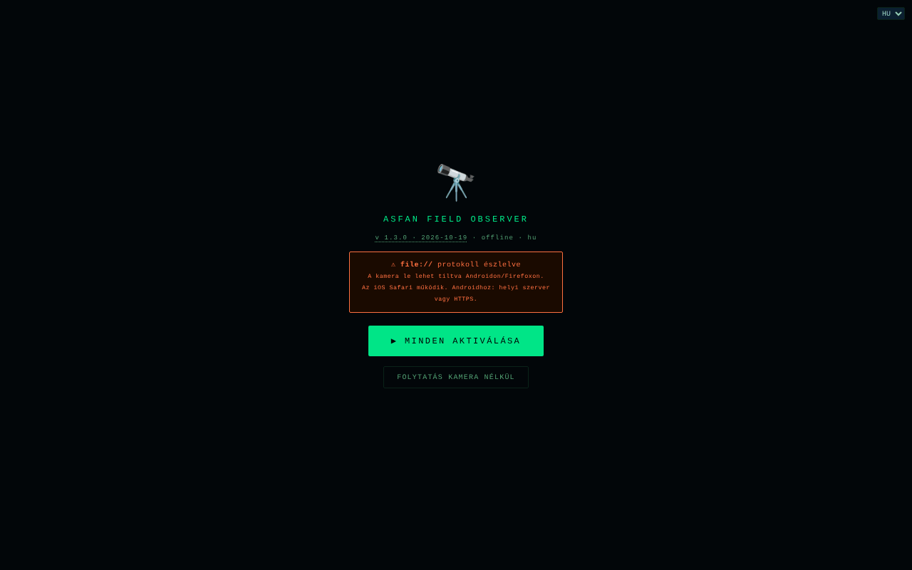

# Field Observer

[English](README.md) · [Română](README.ro.md) · [Français](README.fr.md) · [Italiano](README.it.md) · [Español](README.es.md) · [Português](README.pt.md) · [Deutsch](README.de.md) · **Magyar**

**Verzió:** 1.3.4 · **Utolsó frissítés:** 2026-10-22

A felület nyelvei: **Română, English, Français, Italiano, Español, Português (PT), Deutsch, Magyar**

Terepi megfigyelő a telefonon: GPS, iránytű, mozgás, fény, hang, kamera, NFC és helyben mentett jelentések.

**Online alkalmazás:** https://chiuta.github.io/FieldObserver/

## Mi ez

Az ASFAN Field Observer (v1.2.0) egyetlen fájlból álló, telefonra tervezett alkalmazás, amely valós időben megjeleníti az eszköz szenzoradatait, és lehetővé teszi terepi „jelentések” mentését (szenzoradatok, jegyzet, fénykép, hangfelvétel). A felület 8 nyelvű (RO, EN, FR, IT, ES, PT, DE, HU).

## Funkciók

- Állapotsor: óra, fény (lux), hálózat, akkumulátorszint, GPS-koordináták.
- „▶ ACTIVARE COMPLETĂ” gomb, amely egyetlen mozdulattal kéri el a szükséges engedélyeket; „RESET PERMISIUNI” az újrakezdéshez; a „CONTINUĂ FĂRĂ CAMERĂ” akkor is megnyitja az alkalmazást, ha a kamera/mikrofon nem érhető el (asztali gép, file://).
- Kamerás kereső (hátsó/első kamera; dupla koppintás vált kamerát), grafikus rávetítéssel.
- Panelek: **BUSOLĂ** (azimut és irány), **MIȘCARE** (gyorsulás m/s², szögsebesség °/s), **AUDIO** (szint dB-ben), **LUMINĂ** (lux, ha van szenzor), **BATERIE**, **REȚEA**.
- Gombok: START (kamera), **FOTO**, **AUDIO** (felvétel), **TORȚĂ** (ha az eszköz engedi), **NFC**, **SALVARE**, **ARHIVĂ**.
- QR / EAN-13 / Code 128 / Data Matrix / Aztec kódok felismerése a kameraképben, ahol a böngésző támogatja a `BarcodeDetector`-t.
- Jegyzetmező hangdiktálással (`ro-RO`, ha a böngésző kínál beszédfelismerést), hangos visszaigazolásokkal („Raport salvat”) és rezgéssel.
- Wake Lock a képernyő bekapcsolva tartásához, ahol elérhető.
- Jelentésarchívum: fényképek megtekintése, hanglejátszás, megosztás (Web Share vagy másolás a vágólapra), JSON-letöltés, törlés; keresés jegyzet/dátum szerint, az egész archívum (JSON fényképpel/hanggal) vagy a táblázat (CSV, média nélkül) exportálása, korábban exportált JSON importálása (a mezők ellenőrzésével), koordináták É/D és K/Ny jelöléssel (románul V) és „térkép” hivatkozás (`geo:`, megnyitja a telefon térképalkalmazását), az Esc bezárja a panelt.

## Újdonságok (1.1.0)

- **GPS-nyomvonal** (🥾 TRASEU gomb az alsó sávban): rögzíti a pozíciókat, amíg az oldal nyitva és aktív marad. Új pont akkor kerül hozzáadásra, ha legalább 5 m-re van az előzőtől, a 100 m-nél gyengébb pontosságú pozíciókat figyelmen kívül hagyja; a határ nyomvonalanként 50 000 pont. A nyomvonal fokozatosan mentődik az IndexedDB-be (a `tracks` tároló). **Korlát:** a böngészők nem adnak GPS-t a háttérben lévő vagy kikapcsolt képernyős oldalnak; ilyenkor az adott időközből hiányoznak a pontok (semmit sem interpolál).
- **GPX 1.1 exportálás** (archívum → ⬇ GPX): a jelentések pozíciói pontokká válnak (`wpt`, a leírásban magassággal, idővel, jegyzettel, azimuttal és pontossággal), a nyomvonalak pedig `trk`/`trkseg` elemekké. Megnyílik bármely GPX-et olvasó térkép- vagy GPS-programban. A GPS nélküli jelentések kimaradnak (koordinátákat nem talál ki).
- **`.fff.json` csomag** (archívum → ⬇ .fff.json): az egész archívum (jelentések fényképpel/hanggal és nyomvonalak) egy `fff-bundle` formátumú fájlban, amely az archívumból is importálható (⬆ IMPORT, amely most már ezt a formátumot is elfogadja; az `app` mezőt ellenőrzi). **Megjegyzés:** a kit „Átláthatóság” ablakának biztonsági mentése csak a `localStorage`-zsal működik, az alkalmazás pedig nem használja azt; az archívumhoz az Archívum panel gombjait használd.
- **QR-kód a jelentésen** (▦ QR minden jelentésnél): a kód vagy a pozíciót tartalmazza (`geo:lat,lon`, amelyet a telefon a térképalkalmazásban nyit meg), vagy egy rövid szöveget a dátummal, a pozícióval, az azimuttal és a jegyzettel (az első 300 karakter). Helyben generálva.
- **Nyomtatás** (archívum → 🖨 TIPĂREȘTE): tiszta lista, fehér háttér, gombok és fényképek nélkül.
- **Átláthatóság** (archívum → ℹ TRANSPARENȚĂ): a szabványos „határok nélküli” ablak a hálózattal (0 külső kérés), a tárolással, az engedélyekkel és a fájl SHA-256 szerinti ellenőrzésével.

A felület 8 nyelvű (RO, EN, FR, IT, ES, PT, DE, HU); a romántól eltérő fordítások gépiek, és anyanyelvi beszélők nem ellenőrizték őket.

## „fff-kit” kit

Az `index.html` fájlba beágyazott modulok: `core`, `label`, `bundle`, `qr` (QR-kód-generátor, hálózat nélkül). Nélkülük az alkalmazás ugyanúgy működik, de QR-gomb és Átláthatóság ablak nélkül (tesztelve). Az `app.json` fájl leírja a hálózatot, az engedélyeket és a fájl SHA-256 értékét.

## Tesztek

`node tests/fff-r8.test.mjs` (Playwright, blokkolt hálózat): a tesztkörnyezeten keresztül szimulált pozíciókkal készített nyomvonal (a böngésző valódi helymeghatározási API-ja), GPX (jól formált XML, különleges karakterek), `.fff.json` csomag (exportálás, importálás, idegen csomag elutasítása), a kit dekódolójával visszafejtett QR-kód, nyomtatás, axe-core 0 szabálysértés (a párbeszédablakokat is beleértve), 360 px, a kit nélkül.

## Használati útmutató

1. Nyisd meg az oldalt a telefonon **HTTPS**-en vagy `localhost`-on keresztül (a kamera nem működik nem biztonságos HTTP-n; az alkalmazás figyelmeztetést jelenít meg).
2. Nyomd meg az „▶ ACTIVARE COMPLETĂ” gombot, és add meg az engedélyeket (helyadat, kamera, mikrofon, mozgás-/tájolásérzékelők).
3. Kövesd a BUSOLĂ, MIȘCARE, AUDIO, LUMINĂ, BATERIE, REȚEA paneleket.
4. A kamerához nyomd meg a „START” gombot; a képen végzett dupla koppintás vált kamerát. Használd a „FOTO”, az „AUDIO” (felvétel indítása/leállítása) és a „TORȚĂ” gombot.
5. Írj egy jegyzetet a szövegmezőbe (vagy diktáld a mikrofon gombbal).
6. Nyomd meg a „SALVARE” gombot: a jelentés (idő, GPS, tájolás, mozgás, fény, akkumulátor, hálózat, jegyzet, utolsó fénykép / hangfelvétel) helyben mentődik. Ha az adatbázis nem érhető el, vagy a mentés sikertelen, egy JSON-fájl töltődik le.
7. Az „ARHIVĂ” felsorolja a jelentéseket; innen kereshetsz bennük, megtekintheted, megoszthatod, letöltheted (JSON), törölheted őket, mindent exportálhatsz (JSON/CSV), vagy importálhatsz egy korábban exportált JSON-t.
8. A „◈ NFC” elindítja az NFC-címkék olvasását (ahol a böngésző támogatja a Web NFC-t).

## Adatvédelem és hálózat

- **Helyi tárolás:** IndexedDB, `ASFAN_FO` adatbázis (3. verzió), `recs` (a jelentések, a fényképet és a hangot is beleértve) és `tracks` (a GPS-nyomvonalak, az 1.1.0 óta; a régi adatbázis automatikusan frissül, a jelentések megmaradnak) tárolók. A `localStorage`-ot nem használja.
- **Hálózat:** az alkalmazás nem tartalmaz `fetch` hívásokat, és `connect-src 'self'` CSP-szabályzata van; harmadik fél gazdagépeivel nem lép kapcsolatba. A „Coffee” hivatkozás csak kattintásra nyílik meg.
- Megjegyzés: a hangdiktálás a böngésző beszédfelismerő funkcióját használja, amely egyes böngészőkben (pl. Chrome) hangot küldhet a böngészőgyártó szolgáltatásának; az alkalmazás ezt nem tudja befolyásolni.
- **Érzékeny adatok:** a jelentések GPS-helyadatot, fényképeket, hangfelvételeket és jegyzeteket tartalmaznak, titkosítatlanul tárolva az eszköz IndexedDB-jében; a „SHARE” gomb és a JSON-letöltés kivihetik őket az alkalmazásból. A webhelyadatok törlése törli az archívumot; biztonsági mentéshez exportáld a JSON-t. Megosztott vagy elveszett telefonon a jelentéseket bárki elolvashatja, akinek hozzáférése van a böngészőprofilhoz.
- Analitika nélkül.

## Helyi / offline futtatás

Töltsd le az `index.html` fájlt, és nyisd meg `localhost`-on keresztül (pl. `python3 -m http.server 8080`) vagy HTTPS-gazdagépről; a szenzorokhoz és a kamerához biztonságos környezet kell. Internet nem szükséges. A szenzorok elérhetősége az eszköztől és a böngészőtől függ.

## Előzmények / Changelog

### 1.3.4 — 2026-10-22

fff-kit 1.1.4: érintési célok és minimális szövegméret. Érintési célok/szöveg javítva az alkalmazásban.

### 1.3.3 — 2026-10-22
- Akadálymentesség: jól látható fókuszkeret a jegyzetsávon (legalább 3:1 kontraszt).

### 1.3.2 — 2026-10-22

fff-kit 1.1.2: PBKDF2 600 000 iterációval, clickjacking elleni védelem.

### 1.3.1 — 2026-10-22
- A GPS-t az alkalmazás megnyitásakor már nem kéri el: az engedélykérés az első interakciónál jelenik meg (vagy azonnal, ha már meg volt adva).
- A rekord törlésének megerősítése lefordított modális párbeszédablak a böngésző confirm() helyett.
- Kisegítő lehetőségek: a jegyzetmező és az archívum-importmező neve felolvasható a képernyőolvasókkal.
- Mobil: a szöveg legalább 12 px, a gombok és mezők érintési felülete pedig nagyobb keskeny képernyőn.

### 2026. október 18. — 1.2.0 verzió
- Új: „↗ Bolta” (az ég a GPS-pozíciónál: élőben a GPS-sávban; az archívumban az új jelentéseknél a jelentés helyén és időpontjában). Az új jelentések megőrzik az UTC időpontot (`t`), amelyet a GPX is használ. A hivatkozásban szereplő pozíció ~1 km-re van kerekítve.

### 2026. október 14. — 1.1.0 verzió
- Új: GPS-nyomvonal, GPX 1.1 exportálás, `.fff.json` csomag (exportálás/importálás), QR-kód a jelentésen (pozíció vagy szöveg), az archívum nyomtatása, „Átláthatóság” ablak (fff-kit: core, label, bundle, qr). Az IndexedDB adatbázis a 3. verzióra vált (új `tracks` tároló). Új tesztek: `tests/fff-r8.test.mjs`. CSP: a szkript hashe újraszámolva.

### 2026. október 12. — 1.0.4 verzió
- 1.0.4 — 2026-10-12: a verzió és az utolsó frissítés dátuma megjelenik az alkalmazásban

### 2026. október 11. (harmadik menet) — 1.0.3 verzió
- CSV-exportálás: a `baterie_pct` oszlop a 0–1 törtet írta (1 a 100%-hoz); most a százalékot írja (100).
- Az aktiváló képernyő már nem blokkolja az alkalmazást, ha a kamera nem érhető el (file://, asztali gép): „CONTINUĂ FĂRĂ CAMERĂ” gomb. CSP: hash újraszámolva.

### 2026. október 11. (második menet) — 1.0.2 verzió
- Archívum: keresés, teljes JSON- és CSV-exportálás (a cellák védettek a képletként értelmezés ellen), JSON-importálás a mezők ellenőrzésével, helyes féltekékkel jelölt koordináták (É/D, K/Ny (románul V); korábban rögzített „°N/°E”, negatív értékeknél is) és „térkép” hivatkozás, üres archívum üzenete útmutatással, `aria-label` az emojis gombokon, párbeszédablak fókusszal és Esc-pel, toast `status` régióként. CSP: hash újraszámolva. Képernyőkép frissítve.

### 2026. október 11.
- 1.0.1 verzió (a címben, a kezdőképernyőn és a kód megjegyzésében).
- Akadálymentesség: fejléc (`<header>` `<h1>`-gyel), `<main>` és a támogató widget mint tájékozódási pont; az axe-core 0 szabálysértést jelez 1280 és 360 px mellett.
- A Buy Me a Coffee pirula már nem takarja el a gombsort (AUDIO, TORȚĂ, NFC, ARHIVĂ): jobbra, a kereső közepén áll, keskeny képernyőn pedig összecsukva indul.
- Az „ACTIVARE COMPLETĂ” gomb az aktiválás után „⏳...” állapotban maradt: most „✓ ACTIV” látható.
- Biztonság: a 15 beágyazott `onclick` eseménykezelőt egy delegált eseménykezelő váltotta fel; a CSP SHA-256 hasht használ a szkripthez, `'unsafe-inline'` nélkül a `script-src`-ben.

## Licenc

MIT — lásd a LICENSE fájlt

## Audit

2026-10-10: ellenőrizve, hogy a kód nem tartalmaz `fetch`/XHR/WebSocket hívásokat vagy külső erőforrásokat (szimulált engedélyekkel, hálózati kérések nélkül). Az alkalmazás neve a felületen és az adatbázis neve (`ASFAN_FO`) tartalmazza az „ASFAN” szót; ezt nem módosították. Javítva: a letiltott nagyítás (viewport), a kontraszt és egy rejtett fókuszálható elem.

## Szerző

Alexio — Alexandru-Ionuț Chiuță. Elérhetőség: alexio@trom.tf

## Összefoglaló
A Field Observer egyfájlos, román nyelvű mobil terepi eszköz: élő GPS, iránytű, mozgás, környezeti fény, hangszint, kamera QR-/vonalkód-felismeréssel, zseblámpa és NFC, valamint mentett terepi jelentések (`ASFAN_FO` IndexedDB-adatbázis) jegyzetekkel, fotóval és hanggal, JSON-exporttal és megosztással. Nincsenek hálózati kérések (CSP connect-src 'self'). MIT licenc.

Újdonság az 1.1.0-ban: GPS-nyomvonal rögzítése (csak előtérben), a jelentések és nyomvonalak GPX 1.1 exportja, `.fff.json` archívumcsomag (export/import), jelentésenkénti QR-kód (geo: pozíció vagy rövid szöveg), az archívum nyomtatási nézete és az „Átláthatóság” párbeszédablak. A felület továbbra is csak román nyelvű. A készlet nem ad hozzá hálózati kéréseket.
