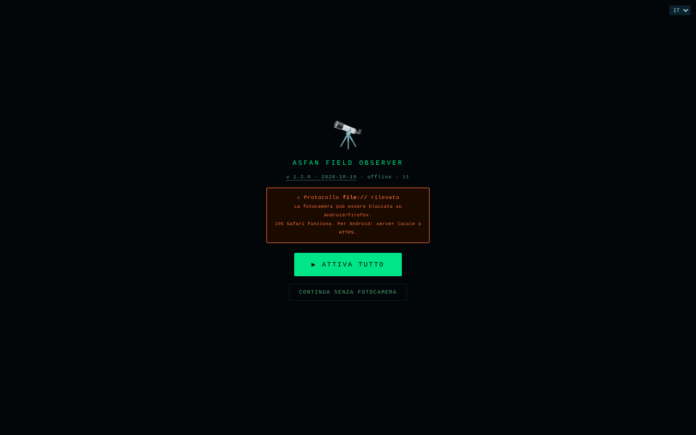

# Field Observer

[English](README.md) · [Română](README.ro.md) · [Français](README.fr.md) · **Italiano** · [Español](README.es.md) · [Português](README.pt.md) · [Deutsch](README.de.md) · [Magyar](README.hu.md)

**Versione:** 1.3.2 · **Ultimo aggiornamento:** 2026-10-22

Lingue dell'interfaccia: **Română, English, Français, Italiano, Español, Português (PT), Deutsch, Magyar**

Osservatore da campo sul telefono: GPS, bussola, movimento, luce, suono, fotocamera, NFC e rapporti salvati localmente.

**App online:** https://chiuta.github.io/FieldObserver/

## Cos'è

ASFAN Field Observer (v1.2.0) è un'applicazione in un unico file, pensata per il telefono, che mostra in tempo reale i dati dei sensori del dispositivo e permette di salvare «rapporti» da campo (dati dei sensori, nota, foto, registrazione audio). L'interfaccia ha 8 lingue (RO, EN, FR, IT, ES, PT, DE, HU).

## Funzioni

- Barra di stato: orologio, luce (lux), rete, livello della batteria, coordinate GPS.
- Pulsante «▶ ACTIVARE COMPLETĂ» che richiede i permessi necessari con un solo gesto; «RESET PERMISIUNI» per ricominciare; «CONTINUĂ FĂRĂ CAMERĂ» apre l'app anche quando fotocamera/microfono non sono disponibili (desktop, file://).
- Mirino con fotocamera (posteriore/anteriore; il doppio tocco cambia fotocamera), con una sovrapposizione grafica.
- Pannelli: **BUSOLĂ** (azimut e direzione), **MIȘCARE** (accelerazione m/s², velocità angolare °/s), **AUDIO** (livello in dB), **LUMINĂ** (lux, se il sensore esiste), **BATERIE**, **REȚEA**.
- Pulsanti: START (fotocamera), **FOTO**, **AUDIO** (registrazione), **TORȚĂ** (se il dispositivo lo consente), **NFC**, **SALVARE**, **ARHIVĂ**.
- Rilevamento di codici QR / EAN-13 / Code 128 / Data Matrix / Aztec nell'immagine della fotocamera, dove il browser supporta `BarcodeDetector`.
- Campo nota con dettatura vocale (`ro-RO`, se il browser offre il riconoscimento vocale), conferme vocali («Raport salvat») e vibrazioni.
- Wake Lock per tenere acceso lo schermo, dove disponibile.
- Archivio dei rapporti: visualizzazione delle foto, riproduzione audio, condivisione (Web Share o copia negli appunti), download JSON, eliminazione; ricerca per nota/data, esportazione dell'intero archivio (JSON con foto/audio) o della tabella (CSV, senza media), importazione di un JSON esportato in precedenza (campi verificati), coordinate con N/S ed E/O (V in romeno) e collegamento «mappa» (`geo:`, apre l'app di mappe del telefono), Esc chiude il pannello.

## Novità (1.1.0)

- **Traccia GPS** (pulsante 🥾 TRASEU nella barra inferiore): registra le posizioni finché la pagina resta aperta e attiva. Viene aggiunto un punto ad almeno 5 m dal precedente e vengono ignorate le posizioni con precisione peggiore di 100 m; il limite è di 50.000 punti per traccia. La traccia viene salvata gradualmente in IndexedDB (l'archivio `tracks`). **Limite:** i browser non forniscono il GPS a una pagina in background o con lo schermo spento; in tal caso i punti mancano per quell'intervallo (nulla viene interpolato).
- **Esportazione GPX 1.1** (archivio → ⬇ GPX): le posizioni dei rapporti diventano punti (`wpt`, con altitudine, ora, nota, azimut e precisione nella descrizione), e le tracce diventano `trk`/`trkseg`. Si apre in qualsiasi programma di mappe o GPS che legga il GPX. I rapporti senza GPS vengono omessi (non si inventano coordinate).
- **Pacchetto `.fff.json`** (archivio → ⬇ .fff.json): l'intero archivio (rapporti, con foto/audio, e tracce) in un file di formato `fff-bundle`, importabile anch'esso dall'archivio (⬆ IMPORT, che ora accetta anche questo formato; `app` viene verificato). **Nota:** la copia di sicurezza della finestra «Trasparenza» del kit funziona solo con `localStorage`, e l'app non lo usa; per l'archivio usate i pulsanti nel pannello Archivio.
- **Codice QR sul rapporto** (▦ QR su ogni rapporto): il codice contiene la posizione (`geo:lat,lon`, che il telefono apre nell'app di mappe) oppure un breve testo con data, posizione, azimut e nota (primi 300 caratteri). Generato localmente.
- **Stampa** (archivio → 🖨 TIPĂREȘTE): elenco pulito, sfondo bianco, senza pulsanti e senza fotografie.
- **Trasparenza** (archivio → ℹ TRANSPARENȚĂ): la finestra standard «senza frontiere» con la rete (0 richieste esterne), l'archiviazione, i permessi e la verifica del file tramite SHA-256.

L'interfaccia ha 8 lingue (RO, EN, FR, IT, ES, PT, DE, HU); le traduzioni diverse dal rumeno sono automatiche e non verificate da madrelingua.

## Kit «fff-kit»

Moduli incorporati in `index.html`: `core`, `label`, `bundle`, `qr` (generatore di codici QR, senza rete). Senza di essi l'app funziona allo stesso modo, ma senza il pulsante QR e senza la finestra Trasparenza (testato). Il file `app.json` descrive la rete, i permessi e lo SHA-256 del file.

## Test

`node tests/fff-r8.test.mjs` (Playwright, rete bloccata): traccia con posizioni simulate tramite il contesto di test (la vera API di geolocalizzazione del browser), GPX (XML ben formato, caratteri speciali), pacchetto `.fff.json` (esportazione, importazione, rifiuto di un pacchetto estraneo), codice QR decodificato di nuovo con il decodificatore del kit, stampa, axe-core 0 violazioni (inclusi i dialoghi), 360 px, senza il kit.

## Guida all'uso

1. Apri la pagina sul telefono, tramite **HTTPS** o `localhost` (la fotocamera non funziona su HTTP non sicuro; l'app mostra un avviso).
2. Premi «▶ ACTIVARE COMPLETĂ» e concedi i permessi (posizione, fotocamera, microfono, sensori di movimento/orientamento).
3. Osserva i pannelli BUSOLĂ, MIȘCARE, AUDIO, LUMINĂ, BATERIE, REȚEA.
4. Premi «START» per la fotocamera; il doppio tocco sull'immagine cambia fotocamera. Usa «FOTO», «AUDIO» (avvio/arresto della registrazione) e «TORȚĂ».
5. Scrivi una nota nel campo di testo (o dettala con il pulsante del microfono).
6. Premi «SALVARE»: il rapporto (ora, GPS, orientamento, movimento, luce, batteria, rete, nota, ultima foto / registrazione audio) viene salvato localmente. Se il database non è disponibile o il salvataggio fallisce, viene scaricato un file JSON.
7. «ARHIVĂ» elenca i rapporti; da lì puoi cercarli, visualizzarli, condividerli, scaricarli (JSON), eliminarli, esportare tutto (JSON/CSV) o importare un JSON esportato in precedenza.
8. «◈ NFC» avvia la lettura dei tag NFC (dove il browser supporta Web NFC).

## Privacy e rete

- **Archiviazione locale:** IndexedDB, database `ASFAN_FO` (versione 3), archivi `recs` (i rapporti, comprese foto e audio) e `tracks` (le tracce GPS, dalla 1.1.0; il vecchio database viene aggiornato automaticamente, i rapporti restano). `localStorage` non viene usato.
- **Rete:** l'app non contiene chiamate `fetch` e ha una policy CSP con `connect-src 'self'`; non contatta host di terze parti. Il link «Coffee» si apre solo al clic.
- Nota: la dettatura vocale usa la funzione di riconoscimento vocale del browser, che in alcuni browser (ad es. Chrome) può inviare audio al servizio del fornitore del browser; l'app non controlla questo aspetto.
- **Dati sensibili:** i rapporti contengono posizione GPS, fotografie, registrazioni audio e note, archiviati non cifrati in IndexedDB sul dispositivo; il pulsante «SHARE» e il download JSON possono portarli fuori dall'app. La cancellazione dei dati del sito elimina l'archivio; esporta il JSON per una copia di sicurezza. Su un telefono condiviso o smarrito, i rapporti possono essere letti da chiunque abbia accesso al profilo del browser.
- Nessuna analitica.

## Esecuzione locale / offline

Scarica `index.html` e aprilo tramite `localhost` (ad es. `python3 -m http.server 8080`) o da un host HTTPS; i sensori e la fotocamera richiedono un contesto sicuro. Non serve Internet. La disponibilità dei sensori dipende dal dispositivo e dal browser.

## Cronologia / Changelog

### 1.3.2 — 2026-10-22

fff-kit 1.1.2: PBKDF2 a 600.000 iterazioni, protezione anti-clickjacking.

### 1.3.1 — 2026-10-22
- Il GPS non viene più richiesto all'apertura: la richiesta di permesso appare alla prima interazione (o subito se già concesso).
- La conferma di eliminazione di una registrazione è una finestra modale tradotta invece del confirm() del browser.
- Accessibilità: il campo note e il campo di importazione dell'archivio hanno nomi annunciati dagli screen reader.
- Mobile: il testo è di almeno 12 px e pulsanti e campi hanno aree tattili più grandi sugli schermi stretti.

### 18 ottobre 2026 — versione 1.2.0
- Novità: «↗ Bolta» (il cielo alla posizione GPS: in diretta nella barra GPS; nell'archivio, per i nuovi rapporti, nel luogo e nel momento del rapporto). I nuovi rapporti conservano l'istante UTC (`t`), usato anche nel GPX. La posizione nel link è arrotondata a ~1 km.

### 14 ottobre 2026 — versione 1.1.0
- Novità: traccia GPS, esportazione GPX 1.1, pacchetto `.fff.json` (esportazione/importazione), codice QR sul rapporto (posizione o testo), stampa dell'archivio, finestra «Trasparenza» (fff-kit: core, label, bundle, qr). Il database IndexedDB passa alla versione 3 (nuovo archivio `tracks`). Nuovi test: `tests/fff-r8.test.mjs`. CSP: hash dello script ricalcolato.

### 12 ottobre 2026 — versione 1.0.4
- 1.0.4 — 2026-10-12: la versione e la data dell'ultimo aggiornamento sono mostrate nell'app

### 11 ottobre 2026 (terzo passaggio) — versione 1.0.3
- Esportazione CSV: la colonna `baterie_pct` scriveva la frazione 0–1 (1 per il 100%); ora scrive la percentuale (100).
- La schermata di attivazione non blocca più l'app quando la fotocamera non è disponibile (file://, desktop): pulsante «CONTINUĂ FĂRĂ CAMERĂ». CSP: hash ricalcolato.

### 11 ottobre 2026 (secondo passaggio) — versione 1.0.2
- Archivio: ricerca, esportazione completa JSON e CSV (celle protette dall'interpretazione come formule), importazione JSON con convalida dei campi, coordinate con gli emisferi corretti (N/S, E/O (V in romeno); prima «°N/°E» fisso, anche per valori negativi) e collegamento «mappa», messaggio di archivio vuoto con indicazioni, `aria-label` sui pulsanti con emoji, dialogo con focus ed Esc, toast come regione `status`. CSP: hash ricalcolato. Schermata aggiornata.

### 11 ottobre 2026
- Versione 1.0.1 (nel titolo, nella schermata iniziale e nel commento del codice).
- Accessibilità: intestazione (`<header>` con `<h1>`), `<main>` e il widget di sostegno come punto di riferimento; axe-core segnala 0 violazioni a 1280 e 360 px.
- La pillola Buy Me a Coffee non copre più la barra dei pulsanti (AUDIO, TORȚĂ, NFC, ARHIVĂ): sta a destra, a metà del mirino, e su schermo stretto parte ridotta.
- Il pulsante «ACTIVARE COMPLETĂ» restava su «⏳...» dopo l'attivazione: ora mostra «✓ ACTIV».
- Sicurezza: i 15 gestori `onclick` inline sono stati sostituiti da un gestore delegato; la CSP usa un hash SHA-256 per lo script, senza `'unsafe-inline'` in `script-src`.

## Licenza

MIT — vedi il file LICENSE

## Audit

2026-10-10: verificato che nel codice non ci sono `fetch`/XHR/WebSocket né risorse esterne (con permessi simulati, nessuna richiesta di rete). Il nome dell'app nell'interfaccia e quello del database (`ASFAN_FO`) contengono «ASFAN»; non è stato modificato. Corretti lo zoom bloccato (viewport), il contrasto e un elemento nascosto focalizzabile.

## Autore

Alexio — Alexandru-Ionuț Chiuță. Contatto: alexio@trom.tf

## Riepilogo

Field Observer è uno strumento mobile da campo in un unico file, in rumeno: GPS in tempo reale, bussola, movimento, luce ambientale, livello audio, fotocamera con rilevamento di QR/codici a barre, torcia e NFC, più rapporti di campo salvati (database IndexedDB `ASFAN_FO`) con note, foto e audio, esportazione JSON e condivisione. Nessuna richiesta di rete (CSP connect-src 'self'). Licenza MIT.

Novità nella 1.1.0: registrazione della traccia GPS (solo in primo piano), esportazione GPX 1.1 di rapporti e tracce, archivio compresso `.fff.json` (esportazione/importazione), codice QR per ogni rapporto (posizione geo: o breve testo), vista di stampa dell'archivio e la finestra «Trasparenza». L'interfaccia resta solo in rumeno. Il kit non aggiunge richieste di rete.
