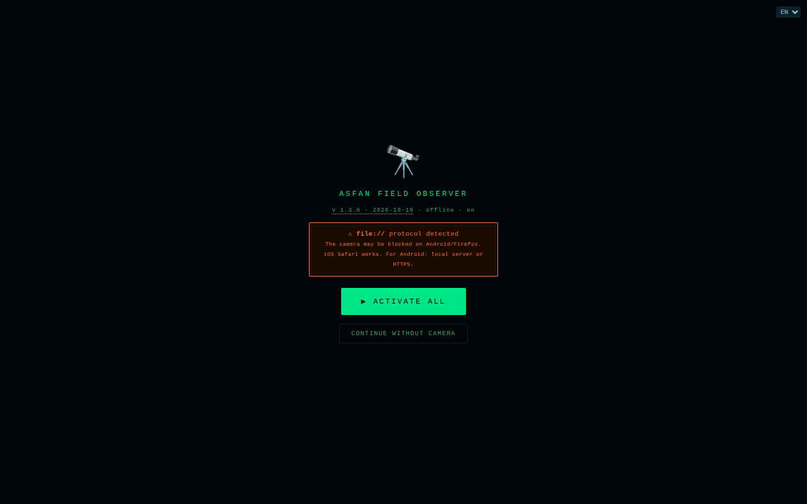

# Field Observer

**English** · [Română](README.ro.md) · [Français](README.fr.md) · [Italiano](README.it.md) · [Español](README.es.md) · [Português](README.pt.md) · [Deutsch](README.de.md) · [Magyar](README.hu.md)

**Version:** 1.3.2 · **Last updated:** 2026-10-22

Interface languages: **Română, English, Français, Italiano, Español, Português (PT), Deutsch, Magyar**

Field observer on your phone: GPS, compass, motion, light, sound, camera, NFC and locally saved reports.

**Live app:** https://chiuta.github.io/FieldObserver/

## What it is

ASFAN Field Observer (v1.2.0) is a single-file application designed for phones, which displays the device's sensor data in real time and allows saving field "reports" (sensor data, note, photo, audio recording). The interface has 8 languages (RO, EN, FR, IT, ES, PT, DE, HU).

## Features

- Status bar: clock, light (lux), network, battery level, GPS coordinates.
- "▶ ACTIVARE COMPLETĂ" button that requests the necessary permissions in a single gesture; "RESET PERMISIUNI" to start over; "CONTINUĂ FĂRĂ CAMERĂ" opens the app even when the camera/microphone are unavailable (desktop, file://).
- Camera viewfinder (rear/front camera; double tap switches the camera), with a graphic overlay.
- Panels: **BUSOLĂ** (azimuth and direction), **MIȘCARE** (acceleration m/s², angular velocity °/s), **AUDIO** (level in dB), **LUMINĂ** (lux, if the sensor exists), **BATERIE**, **REȚEA**.
- Buttons: START (camera), **FOTO**, **AUDIO** (recording), **TORȚĂ** (if the device allows it), **NFC**, **SALVARE**, **ARHIVĂ**.
- Detection of QR / EAN-13 / Code 128 / Data Matrix / Aztec codes in the camera image, where the browser supports `BarcodeDetector`.
- Note field with voice dictation (`ro-RO`, if the browser offers speech recognition), voice confirmations ("Raport salvat") and vibration.
- Wake Lock to keep the screen on, where available.
- Report archive: photo viewing, audio playback, sharing (Web Share or copy to clipboard), JSON download, deletion; search by note/date, export of the whole archive (JSON with photo/audio) or of the table (CSV, without media), import of previously exported JSON (fields validated), coordinates with N/S and E/W (V in Romanian) and a "map" link (`geo:`, opens the phone's maps app), Esc closes the panel.

## New features (1.1.0)

- **GPS track** (🥾 TRASEU button in the bottom bar): records positions while the page stays open and active. A point is added at least 5 m from the previous one and positions with accuracy worse than 100 m are ignored; the limit is 50,000 points per track. The track is saved incrementally in IndexedDB (the `tracks` store). **Limitation:** browsers do not provide GPS to a page in the background or with the screen off; in that case points are missing for that interval (nothing is interpolated).
- **GPX 1.1 export** (archive → ⬇ GPX): report positions become points (`wpt`, with altitude, time, note, azimuth and accuracy in the description), and tracks become `trk`/`trkseg`. It opens in any maps or GPS program that reads GPX. Reports without GPS are omitted (no coordinates are invented).
- **`.fff.json` bundle** (archive → ⬇ .fff.json): the whole archive (reports, with photo/audio, and tracks) in an `fff-bundle` format file, importable also from the archive (⬆ IMPORT, which now accepts this format too; `app` is checked). **Note:** the backup in the kit's "Transparency" window works only with `localStorage`, and the app does not use it; for the archive use the buttons in the Archive panel.
- **QR code on a report** (▦ QR on each report): the code contains either the position (`geo:lat,lon`, which the phone opens in the maps app), or a short text with the date, position, azimuth and note (first 300 characters). Generated locally.
- **Printing** (archive → 🖨 TIPĂREȘTE): a clean list, white background, without buttons and without photos.
- **Transparency** (archive → ℹ TRANSPARENȚĂ): the standard "trade-free" window with the network (0 external requests), storage, permissions and file verification via SHA-256.

The interface has 8 languages (RO, EN, FR, IT, ES, PT, DE, HU); the translations other than Romanian are automatic and not verified by native speakers.

## "fff-kit" kit

Modules embedded in `index.html`: `core`, `label`, `bundle`, `qr` (QR code generator, no network). Without them the app works the same, but without the QR button and without the Transparency window (tested). The `app.json` file describes the network, the permissions and the file's SHA-256.

## Tests

`node tests/fff-r8.test.mjs` (Playwright, network blocked): track with positions simulated through the test context (the browser's real geolocation API), GPX (well-formed XML, special characters), `.fff.json` bundle (export, import, rejection of a foreign bundle), QR code decoded back with the kit's decoder, printing, axe-core 0 violations (including dialogs), 360 px, without the kit.

## User guide

1. Open the page on your phone, over **HTTPS** or `localhost` (the camera does not work over insecure HTTP; the app shows a warning).
2. Press "▶ ACTIVARE COMPLETĂ" and grant the permissions (location, camera, microphone, motion/orientation sensors).
3. Watch the BUSOLĂ, MIȘCARE, AUDIO, LUMINĂ, BATERIE, REȚEA panels.
4. Press "START" for the camera; a double tap on the image switches the camera. Use "FOTO", "AUDIO" (start/stop recording) and "TORȚĂ".
5. Write a note in the text field (or dictate it with the microphone button).
6. Press "SALVARE": the report (time, GPS, orientation, motion, light, battery, network, note, last photo / audio recording) is saved locally. If the database is unavailable or saving fails, a JSON file is downloaded.
7. "ARHIVĂ" lists the reports; from it you can search, view, share, download (JSON), delete them, export everything (JSON/CSV) or import a previously exported JSON.
8. "◈ NFC" starts reading NFC tags (where the browser supports Web NFC).

## Privacy and network

- **Local storage:** IndexedDB, the `ASFAN_FO` database (version 3), the `recs` stores (reports, including photo and audio) and `tracks` (GPS tracks, since 1.1.0; the old database is upgraded automatically, reports remain). `localStorage` is not used.
- **Network:** the app contains no `fetch` calls and has a CSP policy with `connect-src 'self'`; it does not contact third-party hosts. The "Coffee" link opens only on click.
- Note: voice dictation uses the browser's speech recognition feature, which in some browsers (e.g. Chrome) may send audio to the browser vendor's service; the app does not control this.
- **Sensitive data:** reports contain GPS location, photos, audio recordings and notes, stored unencrypted in IndexedDB on the device; the "SHARE" button and the JSON download can take them out of the app. Clearing site data deletes the archive; export JSON for a backup. On a shared or lost phone, the reports can be read by anyone with access to the browser profile.
- No analytics.

## Local / offline use

Download `index.html` and open it via `localhost` (e.g. `python3 -m http.server 8080`) or from an HTTPS host; the sensors and camera require a secure context. No internet required. Sensor availability depends on the device and the browser.

## History / Changelog

### 1.3.2 — 2026-10-22

fff-kit 1.1.2: PBKDF2 with 600,000 iterations, anti-clickjacking protection.

### 1.3.1 — 2026-10-22
- GPS is no longer requested when the app opens: the location permission prompt appears on first interaction (or immediately if it was already granted).
- The record-delete confirmation is a translated modal dialog instead of the browser confirm().
- Accessibility: the notes field and the archive import field now have names announced by screen readers.
- Mobile: text is at least 12 px and buttons and fields have larger touch targets on narrow screens.

### 18 October 2026 — version 1.2.0
- New: "↗ Bolta" (the sky at the GPS position: live in the GPS bar; in the archive, for new reports, at the place and moment of the report). New reports keep the UTC moment (`t`), also used in GPX. The position in the link is rounded to ~1 km.

### 14 October 2026 — version 1.1.0
- New: GPS track, GPX 1.1 export, `.fff.json` bundle (export/import), QR code on a report (position or text), archive printing, the "Transparency" window (fff-kit: core, label, bundle, qr). The IndexedDB database moves to version 3 (new `tracks` store). New tests: `tests/fff-r8.test.mjs`. CSP: the script hash recalculated.

### 12 October 2026 — version 1.0.4
- 1.0.4 — 2026-10-12: the version and the date of the last update are shown in the app

### 11 October 2026 (third pass) — version 1.0.3
- CSV export: the `baterie_pct` column wrote the 0–1 fraction (1 for 100%); it now writes the percentage (100).
- The activation screen no longer blocks the app when the camera is unavailable (file://, desktop): the "CONTINUĂ FĂRĂ CAMERĂ" button. CSP: hash recalculated.

### 11 October 2026 (second pass) — version 1.0.2
- Archive: search, full JSON and CSV export (cells protected against being interpreted as formulas), JSON import with field validation, coordinates with correct hemispheres (N/S, E/W (V in Romanian); previously a fixed "°N/°E", even for negative values) and a "map" link, empty-archive message with guidance, `aria-label` on the emoji buttons, dialog with focus and Esc, toast as a `status` region. CSP: hash recalculated. Screenshot updated.

### 11 October 2026
- Version 1.0.1 (in the title, the start screen and the code comment).
- Accessibility: header (`<header>` with `<h1>`), `<main>` and the support widget as a landmark; axe-core reports 0 violations at 1280 and 360 px.
- The Buy Me a Coffee pill no longer covers the button bar (AUDIO, TORȚĂ, NFC, ARHIVĂ): it sits on the right, in the middle of the viewfinder, and on a narrow screen it starts collapsed.
- The "ACTIVARE COMPLETĂ" button stayed on "⏳..." after activation: it now shows "✓ ACTIV".
- Security: the 15 inline `onclick` handlers were replaced with a delegated handler; the CSP uses a SHA-256 hash for the script, without `'unsafe-inline'` in `script-src`.

## Licence

MIT — see the LICENSE file

## Audit

2026-10-10: verified that the code contains no `fetch`/XHR/WebSocket or external resources (with simulated permissions, no network requests). The app name in the interface and in the database (`ASFAN_FO`) contains "ASFAN"; it was not changed. Fixed the blocked zoom (viewport), the contrast and a hidden focusable element.

## Author

Alexio — Alexandru-Ionuț Chiuță. Contact: alexio@trom.tf

## English summary

Field Observer is a single-file, Romanian-language mobile field tool: live GPS, compass, motion, ambient light, audio level, camera with QR/barcode detection, torch and NFC, plus saved field reports (IndexedDB database `ASFAN_FO`) with notes, photo and audio, JSON export and sharing. No network requests (CSP connect-src 'self'). MIT licence.

New in 1.1.0: GPS track recording (foreground only), GPX 1.1 export of reports and tracks, `.fff.json` archive bundle (export/import), QR code per report (geo: position or short text), print view of the archive, and the "Transparency" dialog. The UI remains Romanian-only. The kit adds no network requests.
