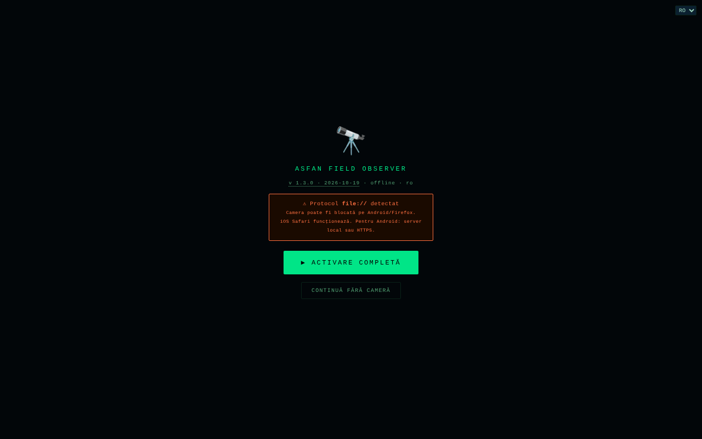

# Field Observer

[English](README.md) · **Română** · [Français](README.fr.md) · [Italiano](README.it.md) · [Español](README.es.md) · [Português](README.pt.md) · [Deutsch](README.de.md) · [Magyar](README.hu.md)

**Versiune:** 1.3.7 · **Ultima actualizare:** 2026-10-23

Limbile interfeței: **Română, English, Français, Italiano, Español, Português (PT), Deutsch, Magyar**

Observator de teren pe telefon: GPS, busolă, mișcare, lumină, sunet, cameră, NFC și rapoarte salvate local.

**Live:** https://chiuta.github.io/FieldObserver/

## Ce este

ASFAN Field Observer (v1.2.0) este o aplicație single-file, gândită pentru telefon, care afișează în timp real datele senzorilor dispozitivului și permite salvarea de „rapoarte" de teren (date de senzori, notă, fotografie, înregistrare audio). Interfața are 8 limbi (RO, EN, FR, IT, ES, PT, DE, HU).

## Funcții

- Bară de stare: ceas, lumină (lux), rețea, nivel baterie, coordonate GPS.
- Buton „▶ ACTIVARE COMPLETĂ" care cere permisiunile necesare dintr-un singur gest; „RESET PERMISIUNI" pentru reluare; „CONTINUĂ FĂRĂ CAMERĂ” deschide aplicația și când camera/microfonul nu sunt disponibile (desktop, file://).
- Vizor cu cameră (cameră spate/față; dublă atingere schimbă camera), cu suprapunere grafică.
- Panouri: **BUSOLĂ** (azimut și direcție), **MIȘCARE** (accelerație m/s², viteză unghiulară °/s), **AUDIO** (nivel în dB), **LUMINĂ** (lux, dacă senzorul există), **BATERIE**, **REȚEA**.
- Butoane: START (cameră), **FOTO**, **AUDIO** (înregistrare), **TORȚĂ** (dacă dispozitivul o permite), **NFC**, **SALVARE**, **ARHIVĂ**.
- Detectare de coduri QR / EAN-13 / Code 128 / Data Matrix / Aztec în imaginea camerei, acolo unde browserul suportă `BarcodeDetector`.
- Câmp de notă cu dictare vocală (`ro-RO`, dacă browserul oferă recunoaștere vocală), confirmări vocale („Raport salvat") și vibrații.
- Wake Lock pentru a ține ecranul aprins, acolo unde este disponibil.
- Arhivă de rapoarte: vizualizare foto, redare audio, partajare (Web Share sau copiere în clipboard), descărcare JSON, ștergere; căutare după notă/dată, export al întregii arhive (JSON cu foto/audio) sau al tabelului (CSV, fără media), import de JSON exportat anterior (câmpuri verificate), coordonate cu N/S și E/V și legătură „hartă” (`geo:`, deschide aplicația de hărți a telefonului), Esc închide panoul.

## Funcții noi (1.1.0)

- **Traseu GPS** (buton 🥾 TRASEU din bara de jos): înregistrează pozițiile cât timp pagina rămâne deschisă și activă. Se adaugă un punct la cel puțin 5 m față de precedentul și se ignoră pozițiile cu precizie mai slabă de 100 m; limita este de 50 000 de puncte pe traseu. Traseul se salvează treptat în IndexedDB (magazia `tracks`). **Limită:** browserele nu oferă GPS unei pagini aflate în fundal sau cu ecranul stins; în acel caz punctele lipsesc din intervalul respectiv (nu se interpolează nimic).
- **Export GPX 1.1** (arhivă → ⬇ GPX): pozițiile rapoartelor devin puncte (`wpt`, cu altitudine, ora, nota, azimutul și precizia în descriere), iar traseele devin `trk`/`trkseg`. Se deschide în orice program de hărți sau GPS care citește GPX. Rapoartele fără GPS sunt omise (nu se inventează coordonate).
- **Pachet `.fff.json`** (arhivă → ⬇ .fff.json): toată arhiva (rapoarte, cu foto/audio, și trasee) într-un fișier de format `fff-bundle`, importabil tot din arhivă (⬆ IMPORT, care acceptă acum și acest format; se verifică `app`). **Notă:** copia de siguranță din fereastra „Transparență” a kitului lucrează doar cu `localStorage`, iar aplicația nu îl folosește; pentru arhivă folosiți butoanele din panoul Arhivă.
- **Cod QR pe raport** (▦ QR la fiecare raport): codul conține fie poziția (`geo:lat,lon`, pe care telefonul o deschide în aplicația de hărți), fie un text scurt cu data, poziția, azimutul și nota (primele 300 de caractere). Generat local.
- **Tipărire** (arhivă → 🖨 TIPĂREȘTE): listă curată, fundal alb, fără butoane și fără fotografii.
- **Transparență** (arhivă → ℹ TRANSPARENȚĂ): fereastra standard „fără frontiere” cu rețeaua (0 cereri externe), stocarea, permisiunile și verificarea fișierului prin SHA-256.

Interfața are 8 limbi (RO, EN, FR, IT, ES, PT, DE, HU); traducerile în afară de română sunt automate și neverificate de vorbitori nativi.

## Kit „fff-kit”

Module lipite în `index.html`: `core`, `label`, `bundle`, `qr` (generator de cod QR, fără rețea). Fără ele aplicația funcționează la fel, dar fără butonul QR și fără fereastra Transparență (testat). Fișierul `app.json` descrie rețeaua, permisiunile și SHA-256 al fișierului.

## Teste

`node tests/fff-r8.test.mjs` (Playwright, rețea blocată): traseu cu poziții simulate prin contextul de test (API-ul real de geolocalizare al browserului), GPX (XML bine format, caractere speciale), pachet `.fff.json` (export, import, respingerea unui pachet străin), cod QR decodat înapoi cu decodorul kitului, tipărire, axe-core 0 violări (inclusiv dialoguri), 360 px, fără kit.

## Manual de utilizare

1. Deschideți pagina pe telefon, pe **HTTPS** sau `localhost` (camera nu funcționează pe HTTP nesecurizat; aplicația afișează un avertisment).
2. Apăsați „▶ ACTIVARE COMPLETĂ" și acordați permisiunile (locație, cameră, microfon, senzori de mișcare/orientare).
3. Urmăriți panourile BUSOLĂ, MIȘCARE, AUDIO, LUMINĂ, BATERIE, REȚEA.
4. Apăsați „START" pentru cameră; dublă atingere pe imagine schimbă camera. Folosiți „FOTO", „AUDIO" (pornire/oprire înregistrare) și „TORȚĂ".
5. Scrieți o notă în câmpul de text (sau dictați-o cu butonul de microfon).
6. Apăsați „SALVARE": raportul (timp, GPS, orientare, mișcare, lumină, baterie, rețea, notă, ultima fotografie / înregistrare audio) este salvat local. Dacă baza de date nu e disponibilă sau salvarea eșuează, se descarcă un fișier JSON.
7. „ARHIVĂ" listează rapoartele; din ea le puteți căuta, vizualiza, partaja, descărca (JSON), șterge, exporta tot (JSON/CSV) sau importa un JSON exportat anterior.
8. „◈ NFC" pornește citirea etichetelor NFC (unde browserul suportă Web NFC).

## Confidențialitate și rețea

- **Stocare locală:** IndexedDB, baza `ASFAN_FO` (versiunea 3), magaziile `recs` (rapoartele, inclusiv foto și audio) și `tracks` (traseele GPS, de la 1.1.0; baza veche se actualizează automat, rapoartele rămân). Nu se folosește `localStorage`.
- **Rețea:** aplicația nu conține apeluri `fetch` și are o politică CSP cu `connect-src 'self'`; nu contactează hosturi terțe. Linkul „Coffee" se deschide doar la clic.
- Notă: dictarea vocală folosește funcția de recunoaștere vocală a browserului, care în unele browsere (de ex. Chrome) poate trimite audio către serviciul furnizorului browserului; aplicația nu controlează acest aspect.
- **Date sensibile:** rapoartele conțin locație GPS, fotografii, înregistrări audio și note, stocate necriptat în IndexedDB pe dispozitiv; butonul „SHARE" și descărcarea JSON le pot scoate din aplicație. Ștergerea datelor site-ului șterge arhiva; exportați JSON pentru backup. Pe un telefon partajat sau pierdut, rapoartele pot fi citite de oricine are acces la profilul browserului.
- Fără analitice.

## Rulare locală / offline

Descărcați `index.html` și deschideți-l prin `localhost` (de ex. `python3 -m http.server 8080`) sau de pe un host HTTPS; senzorii și camera cer un context sigur. Nu necesită internet. Disponibilitatea senzorilor depinde de dispozitiv și de browser.

## Istoric / Changelog

### 1.3.7 — 2026-10-23

- Corectat: importul unui pachet .fff.json cu conținut intern `null` nu mai aruncă excepție necaptată (acum afișează „fără înregistrări valide”); hash CSP recalculat.

### 1.3.6 — 2026-10-23
- Dialogurile native alert/confirm/prompt au fost înlocuite cu dialoguri FFF.dialog accesibile și traduse (fff-kit 1.2.0).

### 1.3.4 — 2026-10-22

fff-kit 1.1.4: ținte tactile și text minim. Ținte tactile/text corectate în aplicație.

### 1.3.3 — 2026-10-22
- Accesibilitate: inel de focalizare clar la bara de notițe (contrast de cel puțin 3:1).

### 1.3.2 — 2026-10-22

fff-kit 1.1.2: PBKDF2 600 000 iterații, protecție anti-clickjacking.

### 1.3.1 — 2026-10-22
- GPS-ul nu mai este cerut la deschiderea aplicației: cererea de permisiune apare la prima interacțiune (sau imediat dacă era deja acordată).
- Confirmarea ștergerii unei înregistrări este un dialog modal tradus, nu confirm() al browserului.
- Accesibilitate: câmpul de notițe și câmpul de import al arhivei au nume anunțate de cititoarele de ecran.
- Mobil: textul are cel puțin 12 px, iar butoanele și câmpurile au ținte tactile mai mari pe ecrane înguste.

### 18 octombrie 2026 — versiunea 1.2.0
- Nou: „↗ Bolta” (cerul la poziția GPS: live în bara GPS; în arhivă, pentru rapoartele noi, la locul și momentul raportului). Rapoartele noi păstrează momentul UTC (`t`), folosit și în GPX. Poziția din link e rotunjită la ~1 km.

### 14 octombrie 2026 — versiunea 1.1.0
- Nou: traseu GPS, export GPX 1.1, pachet `.fff.json` (export/import), cod QR pe raport (poziție sau text), tipărirea arhivei, fereastra „Transparență” (fff-kit: core, label, bundle, qr). Baza IndexedDB trece la versiunea 3 (magazie nouă `tracks`). Testele noi: `tests/fff-r8.test.mjs`. CSP: hash-ul scriptului recalculat.

### 12 octombrie 2026 — versiunea 1.0.4
- 1.0.4 — 2026-10-12: versiunea și data ultimei actualizări sunt afișate în aplicație

### 11 octombrie 2026 (a treia trecere) — versiunea 1.0.3
- Export CSV: coloana `baterie_pct` scria fracția 0–1 (1 pentru 100%); acum scrie procentul (100).
- Ecranul de activare nu mai blochează aplicația când camera nu e disponibilă (file://, desktop): butonul „CONTINUĂ FĂRĂ CAMERĂ”. CSP: hash recalculat.

### 11 octombrie 2026 (a doua trecere) — versiunea 1.0.2
- Arhivă: căutare, export complet JSON și CSV (celule protejate contra interpretării ca formule), import JSON cu validarea câmpurilor, coordonate cu emisfere corecte (N/S, E/V; înainte „°N/°E” fix, chiar și pentru valori negative) și legătură „hartă”, mesaj de arhivă goală cu îndrumare, `aria-label` pe butoanele cu emoji, dialog cu focus și Esc, toast ca regiune `status`. CSP: hash recalculat. Captură actualizată.

### 11 octombrie 2026
- Versiune 1.0.1 (în titlu, ecranul de start și comentariul din cod).
- Accesibilitate: antet (`<header>` cu `<h1>`), `<main>` și widgetul de sprijin ca reper; axe-core raportează 0 încălcări la 1280 și 360 px.
- Pastila Buy Me a Coffee nu mai acoperă bara de butoane (AUDIO, TORȚĂ, NFC, ARHIVĂ): stă la dreapta, la mijlocul vizorului, iar pe ecran îngust pornește restrânsă.
- Butonul „ACTIVARE COMPLETĂ” rămânea pe „⏳...” după activare: acum arată „✓ ACTIV”.
- Securitate: cele 15 handler-e `onclick` inline au fost înlocuite cu un handler delegat; CSP folosește hash SHA-256 pentru script, fără `'unsafe-inline'` în `script-src`.

## Licență

MIT — vezi fișierul LICENSE

## Audit

2026-10-10: verificat că în cod nu există `fetch`/XHR/WebSocket sau resurse externe (cu permisiuni simulate, fără cereri de rețea). Numele aplicației din interfață și al bazei de date (`ASFAN_FO`) conține „ASFAN"; nu a fost modificat. Corectate zoom-ul blocat (viewport), contrastul și un element ascuns focusabil.

## Autor

Alexio — Alexandru-Ionuț Chiuță. Contact: alexio@trom.tf

## Rezumat

Field Observer este un instrument mobil de teren într-un singur fișier, în limba română: GPS în direct, busolă, mișcare, lumină ambientală, nivel audio, cameră cu detectare de coduri QR/bare, lanternă și NFC, plus rapoarte de teren salvate (baza de date IndexedDB `ASFAN_FO`) cu notițe, fotografie și audio, export JSON și partajare. Fără cereri de rețea (CSP connect-src 'self'). Licență MIT.

Noutăți în 1.1.0: înregistrarea traseului GPS (doar în prim-plan), export GPX 1.1 al rapoartelor și traseelor, pachet de arhivă `.fff.json` (export/import), cod QR pentru fiecare raport (poziție geo: sau text scurt), vizualizare de tipărire a arhivei și dialogul „Transparență”. Interfața rămâne doar în română. Kitul nu adaugă cereri de rețea.
